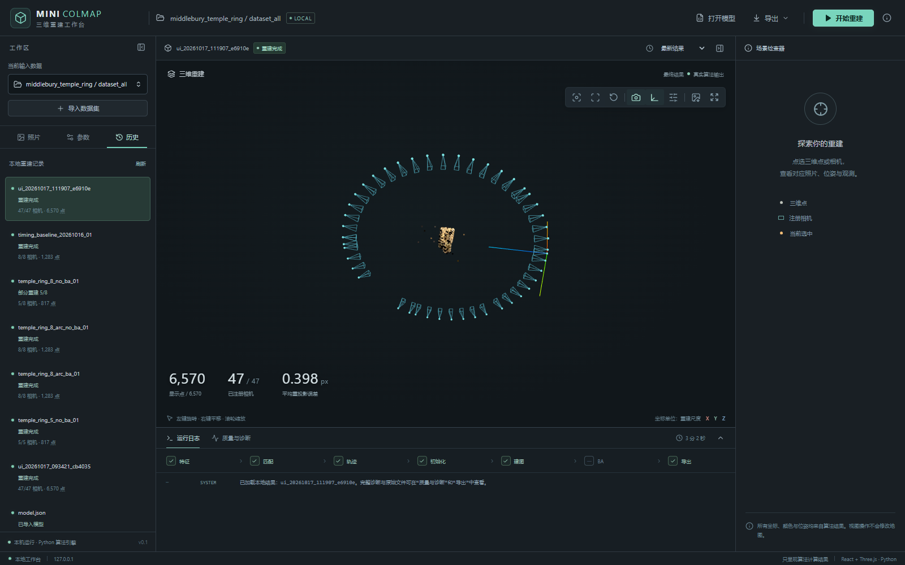
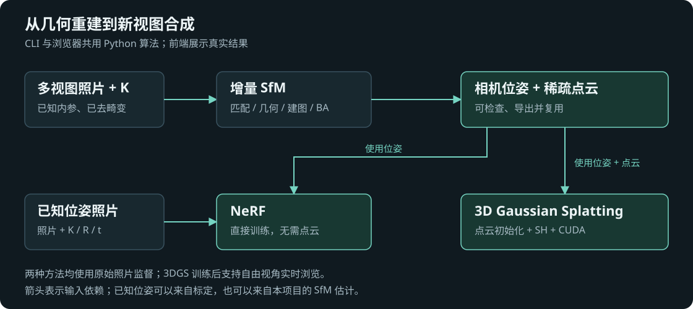
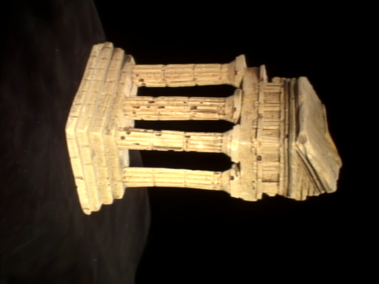
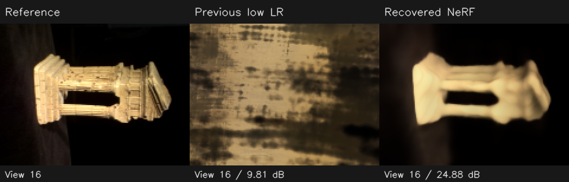
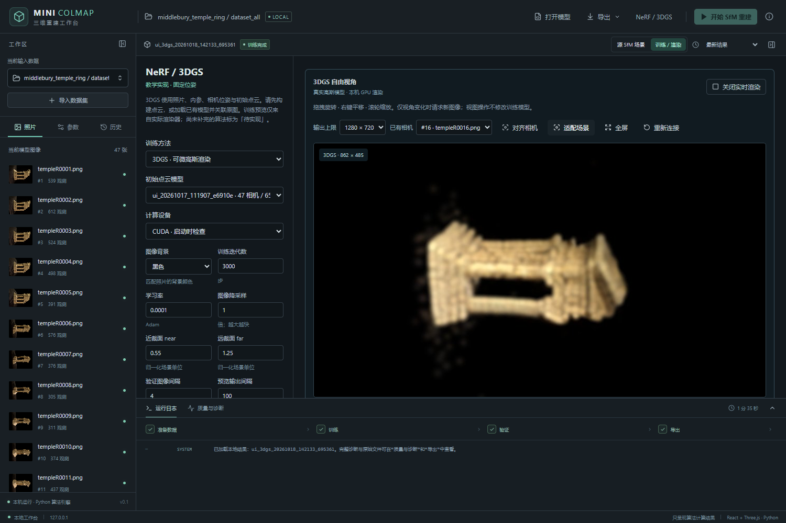

# Mini-COLMAP

**从多视图照片到稀疏重建、NeRF 与 3D Gaussian Splatting 的本地三维视觉工作台。**

Python 实现几何估计与可微渲染数学，React + Three.js 提供交互式结果检查，CUDA/gsplat 支持训练后的高斯实时渲染。数据导入、参数配置、任务进度、质量诊断和模型导出在同一个浏览器界面中完成。



*真实 TempleRing 重建：47/47 台相机注册，6,570 个三维点。照片、相机、点轨迹与重投影误差可联动检查。*

## 功能概览

| 模块 | 已实现功能 |
| --- | --- |
| 增量 SfM | SIFT 匹配、自适应 F-RANSAC、E 分解与两视图初始化、冲突轨迹处理、PnP 注册、多视图补点、可选 Bundle Adjustment |
| 初始化优化 | 按候选匹配数排序，以有效点数上界剪枝，保留平局候选的视差比较；输出候选与剪枝诊断 |
| NeRF | 位置编码、带视角分支的 MLP、射线采样、体渲染、训练/验证划分、检查点与新视角渲染；支持直接使用已知位姿照片 |
| 3DGS | 各向异性协方差、投影、Alpha 合成、0–3 阶实球谐颜色；屏幕梯度增密/分裂、Adam 状态迁移、分组学习率与 L1＋SSIM；reference/gsplat 后端 |
| 三维检查 | 点云与相机视锥、RGB/误差/轨迹长度着色、观测叠加、阶段快照、平滑对齐相机并保持自由操作 |
| 实时与任务管理 | 独立计算进程、SSE 进度、取消与重连、历史结果、失效索引清理；3DGS 常驻 GPU + WebSocket 图像流 |
| 数据与导出 | 标定照片清单、Middlebury 数据准备、JSON/PLY/COLMAP TXT、训练权重与高斯参数归档 |

## 三条处理路径



NeRF 需要照片、内参和位姿，**无需先构建点云**；3DGS 则需要点云初始化。仅有照片和内参时，先运行 SfM 估计位姿。带官方位姿的数据与本项目估计的位姿在输入和实验记录中分别标明。

## 结果与性能

以下是本项目在 Middlebury 数据上的场景实验，非跨数据集基准排名。完整口径与记录见 [实验结果](docs/evaluation.md)。

| 项目 | 实测结果 | 条件 |
| --- | --- | --- |
| TempleRing SfM | **47/47 相机，6,570 点，平均误差 0.398 px** | 640×480 输入，最终全局 BA 关闭 |
| 两视图初始化优化 | **31.761 s → 1.097 s，约 29×** | 同一 47 图配置；历史记录核对新旧完整模型一致，单次对照 |
| NeRF 新视角 | **24.17 dB PSNR** | 47 图，36 训练 / 11 验证，160×120，6,000 步 |
| 3DGS 新视角 | **31.83 dB PSNR** | TempleRing，36 / 11 视图，160×120，5,000 步，6,726 高斯 |
| 3DGS 训练策略消融 | **26.45 → 36.02 dB PSNR，0.7870 → 0.9546 SSIM** | Temple312，同地图、同迭代数，640×480，10,000 步，297 训练 / 8 dev / 7 test；单种子原图确认 |
| 3DGS 实时链路 | **54.22 帧/秒的新图像提交，P95 29.8 ms** | RTX 4060 Laptop，100,000 高斯，1280×720，headless Edge，测量 60 s |

实时数字统计浏览器 RAF 中提交的新渲染图像，包含 CUDA 渲染、读回、JPEG 传输与解码，未测量显示器刷新率。高斯容量允许设置到 500 万；该上限不代表百万规模训练或实时性能已验证。

| 原始测试视图 | 3DGS 渲染 |
| :---: | :---: |
|  |  |

*同一测试相机、640×480；36.02 dB 使用 7 个固定测试视角的平均 MSE 计算，非此单图分数。固定 SfM 地图下的单场景原图确认，未联合优化相机。*

<details>
<summary>查看 NeRF 与实时渲染界面</summary>



*NeRF 验证视角示例：原图 / 低学习率对照 / 轮廓恢复后的模型。示例单视角分数与全部视角平均分数不同。*



*真实训练权重的自由视角渲染，支持旋转、平移、缩放及已有相机对齐。*

</details>

## 快速开始

建议使用 **Python 3.12**。基础 SfM 与工作台可在 CPU 运行；GPU 渲染环境另见 [安装与使用](docs/usage.md#gpu-环境)。以下命令均在项目根目录执行。

```powershell
python -m venv .venv
.\.venv\Scripts\python.exe -m pip install -e ".[dev,ui,ui-test]"
.\.venv\Scripts\python.exe scripts/prepare_middlebury.py
.\.venv\Scripts\python.exe -m minicolmap ui
```

浏览器打开 `http://127.0.0.1:8765`。选择 `middlebury_temple_ring`（连续 8 图），点击开始重建；完整 47 图清单为 `dataset_all.json`。数据准备脚本会下载公开照片，已有目录非空时拒绝覆盖，无需重复执行。

前端生产资源随 Python 包提供，日常使用无需 Node 或在线 CDN。原始数据与训练权重不随仓库分发，结果可通过上述步骤重新生成。

命令行也可独立使用：

```powershell
.\.venv\Scripts\python.exe -m minicolmap run --dataset data/middlebury_temple_ring/dataset.json --output outputs/temple_demo --config configs/temple_ring_no_ba.json
.\.venv\Scripts\python.exe -m minicolmap inspect outputs/temple_demo/model.json
```

每次运行使用新的输出目录。NeRF/3DGS 训练、GPU 安装及已有结果导入见 [使用指南](docs/usage.md)。

## 架构与核心实现

| 层次 | 主要代码 | 职责 |
| --- | --- | --- |
| 多视图几何 | [geometry.py](src/minicolmap/geometry.py)、[tracks.py](src/minicolmap/tracks.py)、[mapper.py](src/minicolmap/mapper.py) | F/E、三角化、轨迹、初始化及增量地图管理 |
| 非线性优化 | [ba.py](src/minicolmap/ba.py)、[optimization.py](src/minicolmap/optimization.py) | 重投影残差、两视图精化、BA 与候选接受检查 |
| 新视图合成 | [algorithms.py](src/minicolmap/rendering/algorithms.py)、[pipeline.py](src/minicolmap/rendering/pipeline.py) | NeRF / 3DGS 数学、训练、验证与权重保存 |
| 任务服务 | [ui/](src/minicolmap/ui) | FastAPI、子进程、SSE、场景快照、WebSocket 实时会话 |
| 交互界面 | [web/src/](web/src) | React、TypeScript、Three.js 与 OrbitControls |

核心几何、轨迹管理、渲染数学与训练流程可直接审阅。SIFT 和 PnP 使用 OpenCV，非线性求解使用 SciPy，自动微分使用 PyTorch，CUDA 高斯光栅使用 gsplat；库适配与数学实现的边界见 [架构说明](docs/architecture.md)。

## 测试与复现

```powershell
# exercises/ 保留专项算法回归测试；实现已完成
.\.venv\Scripts\python.exe -m pytest tests exercises -q

# 前端开发与验证需要 Node.js
cd web
npm ci
npm test
npm run build
```

测试覆盖几何退化、含噪对应、初始化剪枝、地图一致性、可微渲染、CUDA/reference 对照、任务接口与视角转换。浏览器验收和 GPU 自检需准备相应数据、结果及设备，见 [验证方法](docs/evaluation.md#验证方法)。

## 文档

- [使用指南](docs/usage.md)：安装、数据准备、工作台、CLI、GPU 与常见问题。
- [架构说明](docs/architecture.md)：算法流程、模块职责、数学约定、实时链路与实现边界。
- [参数与数据格式](docs/configuration.md)：完整配置、输入清单、模型与训练产物。
- [实验结果](docs/evaluation.md)：可核对的指标、性能条件与复现入口。
- [3DGS 优化与消融](docs/3dgs-optimization-ablation.md)：Adam 状态迁移、分组学习率、密度策略、损失及受控实验。

当前重点是小型静态场景的稀疏重建与新视图合成。尚不支持未知内参自动标定、稠密 MVS、网格重建、联合位姿训练或完整 COLMAP 模型导入；NeRF 与 3DGS 的画质和大规模性能仍有优化空间。
