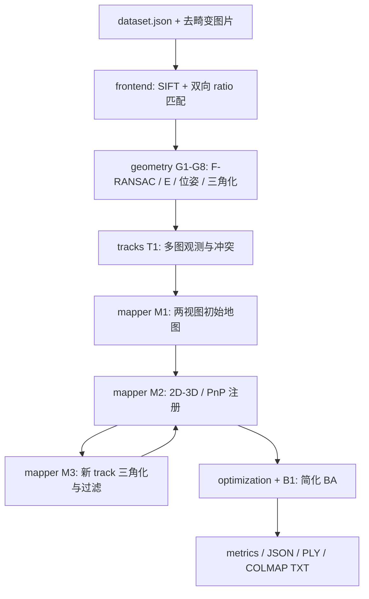

# Mini-COLMAP 开发文档

## 1. 项目定位与完成定义

你已有 Video-LLM/时序定位/模型训练背景，并已接触相机投影、数值优化、SIFT。
极几何、SfM 与新项目的完成情况尚无证据。本项目将这些基础变成可复现的传统多视图几何系统，
为“视频与多模态 → 三维几何 → 空间智能”的实习叙事提供实际支撑。

第一版完成意味着：同一套 CLI 在可靠内参的真实静态场景上，从 SIFT 开始恢复多个相机和稀疏点；
能输出误差/注册率、展示点云、导入 COLMAP 文本模型，并解释失败条件。
生成数据、通过投影测试、用真实位姿直接三角化，分别只是局部验收。

## 2. 范围与约束

| 第一版必须实现 | 后续可选 |
|---|---|
| Python 3.10+、NumPy/OpenCV/SciPy、CPU 离线 | C++/Eigen/Ceres 重写一个模块 |
| 已知内参、已去畸变、静态场景 | 内参/畸变联合估计、自动去畸变工具 |
| 先 3–8 图调通，再 20–60 图小场景 | 大规模检索/多组件合并/回环 |
| 两视图初始化、track、PnP 注册、新点过滤 | 更强初始化退化检测、多视图非线性三角化 |
| 固定初始两相机的简化 BA | 完整 gauge 约束、稀疏 Jacobian/Schur |
| JSON、PLY、COLMAP TXT、实验报告 | COLMAP BIN、3DGS 接入与新视角指标 |

本版无需 GUI、MVS 稠密重建、Mesh、SLAM、CUDA 或神经网络训练。
已知内参不是从图片宽度猜一个焦距；初版用标定后的数据，近似内参另列试验。

## 3. 工程架构



箭头表示数据依赖。新增图像的循环在没有注册进展时结束；未注册图像要留下原因。

```text
miniColmap/                         根目录 D:\yy_folder\miniColmap
├── README.md / pyproject.toml / configs/default.json
├── docs/          开发、数学、验收与进度
├── src/minicolmap/
│   ├── cli.py, config.py, pipeline.py   已连接的入口与流程
│   ├── models.py, io.py, export.py      数据与格式
│   ├── frontend.py, backends.py         SIFT/匹配/PnP 库包装
│   ├── geometry.py                     G1–G8
│   ├── tracks.py                       T1
│   ├── mapper.py                       M1–M3
│   ├── ba.py, optimization.py           B1/求解器
│   └── synthetic.py, metrics.py        测试夹具与测量
├── tests/core/     学习算法的公开测试
├── tests/support/  已完成工程功能测试
├── examples/ / data/ / outputs/
└── reports/       实验报告与面试准备
```

## 4. 唯一的数学与类型约定

全项目采用列向量公式，数组以行存储，核心计算 float64。

\[
X_c=R_{cw}X_w+t_{cw},\quad C_w=-R_{cw}^{T}t_{cw},\quad
\tilde x=K[R_{cw}\mid t_{cw}]\tilde X_w.
\]

`R(3,3)` 是 world-to-camera，`t(3,)` 不是相机位置；相机 x 向右、y 向下、z 向前。
行存储代码为 `Xc = X @ R.T + t`。`K` 的焦距与主点单位为像素，最后一行 `[0,0,1]`。
MVP 使用零 skew 的 PINHOLE，允许不同相机 K 的几何/导出；提供的简化 BA 暂要求共享 K。

\[
\tilde x_2^T F\tilde x_1=0,\qquad E=K_2^T F K_1.
\]

`F` 用像素，`E` 用标定射线。像素观测配 `P=K[R|t]`，归一化观测配 `P=[R|t]`，禁止混用。
`sampson_distance` 返回平方像素近似误差，比较 `threshold_px**2`。
普通重投影误差返回欧氏像素距离。初始 `||t2||=1` 只设定任意尺度，不输出真实米制距离。

## 5. 数据结构与不变量

| 实体 | 字段与用途 |
|---|---|
| Camera | `id,width,height,K`；同一 Camera 可由多张图共享 |
| ImageRecord | `id,name,camera_id,keypoints(N,2)`；关键点数组顺序固定 |
| Pose | `R,t`；只在成功注册后存进 model.poses |
| Point3D | `id,xyz(3,),color(3,),observations((image_id,keypoint_idx),...)` |
| Reconstruction | cameras/images/poses/points 的 ID 字典 |
| VerifiedPair | 两 image ID、已验证内点 keypoint indices、F |
| track | 同一场景点的 `(image_id,keypoint_idx)` 观测集合 |

ID 为正整数且不要求连续；keypoint_idx 是当前 keypoints 数组的零基下标。
每个 track 每张图最多一条观测；一个观测最多关联一个 3D 点；一个点至少有两张已注册图的观测。
只导出已注册相机，未重建关键点的 POINT3D_ID 为 -1。数据管理用 ID 字典，线性代数打包时显式建 index map。
所有地图写入后调用 `validate_reconstruction`；点的正深度、视差与误差在 mapper 过滤，不能只靠结构校验。

## 6. 核心接口与所有权

| TODO | 文件/函数 | 输入 → 输出 |
|---|---|---|
| G1 | geometry.project_points | X,K,R,t → pixels(N,2),depth(N,) |
| G2 | normalize_points | pixels → 归一化点,T |
| G3 | eight_point | 两组 N≥8 像素 → F(3,3) |
| G4 | sampson_distance | F,两组像素 → squared distance(N,) |
| G5 | ransac_fundamental | 对应、阈值/次数/seed → F,mask |
| G6 | essential_from_fundamental | F,K1,K2 → 约束后的 E |
| G7 | triangulate_points | P1,P2,两组点 → X(N,3)，退化行为 NaN |
| G8 | recover_relative_pose | E、像素、K → R,t,可用 mask |
| T1 | tracks.build_tracks | 验证匹配字典 → 无冲突 tracks |
| M1 | mapper.initialize_map | model,pairs,tracks,config,feature_colors → 初始地图 |
| M2 | register_next_image | model,pairs,tracks,config → 恰好加一相机时 True |
| M3 | triangulate_new_tracks | model,tracks,config,feature_colors → 新增点数 |
| B1 | ba.bundle_residuals | pose/point/观测索引 → 长度2O残差 |

读取代码 docstring 获取完整边界和异常行为，公开测试是最低验收线。
M1–M3 的跨模块决策属于你负责的项目内容；框架不通过隐藏参考解或 pycolmap 绕过这些步骤。

## 7. 配置、诊断与失败行为

`configs/default.json` 只是起始参数：ratio=0.75，Sampson 阈值=1.5 px，注册误差=3 px、视差角=1.5°。
一次实验只改变一类参数。全匹配是 O(C²)，先用小图集；最多保存前10个合格图对的预览，每图100条线。
输出保存 config、pair 内点数/拒绝理由、feature/match NPZ、run_status、误差和未注册图 ID。
TODO 退出码2，输入/运行错误退出码1，成功退出码0；`completed` 表示流程结束，不保证演示验收目标达标。
优化与真实数据不可用时，先完成合成几何阶段；不要把失败硬改成成功返回。

## 8. 参考与延伸

已于2026-10-14核对 [COLMAP 格式](https://colmap.github.io/format.html)、
[OpenCV calib3d](https://docs.opencv.org/4.13.0/d9/d0c/group__calib3d.html)、
[SciPy least_squares](https://docs.scipy.org/doc/scipy/reference/generated/scipy.optimize.least_squares.html)。
导出沿用无 rig 的兼容三文件文本格式；四元数 Hamilton、wxyz、world-to-camera。
上述官方来源分别支持格式/位姿、PnP/相机、优化器行为；学习预算与本项目范围是针对你的设计选择。

基础教材仍保留在原 Obsidian 库，可按需查阅：

- [三维重建基础与极几何](D:/yy_folder/研究生课题/研究生课题/02-周计划/2026-W40/03-三维重建基础与极几何.md)
- [三角化与位姿](D:/yy_folder/研究生课题/研究生课题/02-周计划/2026-W41/02-多视图几何上-三角化与位姿.md)
- [优化与BA](D:/yy_folder/研究生课题/研究生课题/02-周计划/2026-W41/03-多视图几何下-优化与BA.md)
- [SfM系统与COLMAP](D:/yy_folder/研究生课题/研究生课题/02-周计划/2026-W42/01-SfM系统与COLMAP.md)

下一步：[里程碑与开发步骤](02-里程碑与开发步骤.md)。
