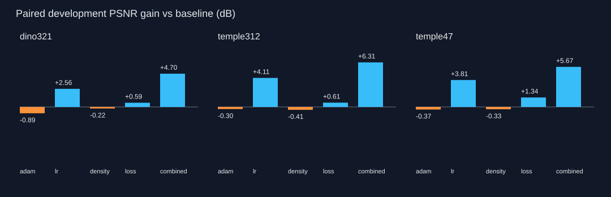
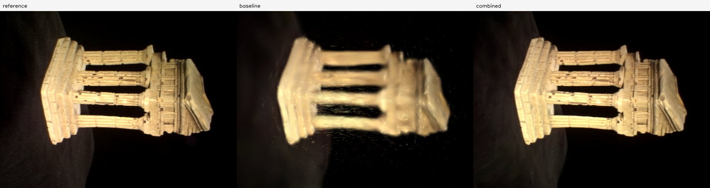

# 3DGS 训练优化与消融实验

本文说明 2026-10-19 起实施的代码改动、对照方法、结果文件和复现步骤。算法改动由本次任务实现；原始 SfM 模型、照片和已有训练输出保持只读。本次评估本项目训练策略的工程改进，数学实现与 CUDA 库的职责见文末。

## 为什么修改

原训练器每到增密间隔，就把所有高斯重新包装成 Parameter，并创建全新的 Adam。即使拓扑未改变，已有高斯的一阶动量、二阶动量及步数也被丢弃。另一方面，位置、尺度、旋转、SH 和透明度共用一个学习率；密度控制只看一次三维中心梯度；损失只有 MSE。这些机制均可执行并通过原有数学测试，但不保证实际画质最佳。

本次保留可显式选择的旧行为，以便测量改动收益，而不是拿不同分辨率、地图或训练步数的历史分数做对照。

## 修改清单与机制

### 1. 拓扑改变时迁移 Adam 状态

新增 `src/minicolmap/rendering/gaussian_training.py`，集中实现训练策略。原 `algorithms.densify_and_prune` 仅扩展可选参数 `return_lineage=True`；原调用仍返回同样的字典，新调用额外获得输出行对应的旧行索引及新增行标记，原有剪枝/子高斯公式不变。

例如旧高斯行 `[A,B,C]` 变为 `[C,A,A的子高斯]` 时，Adam 的 `exp_avg`、`exp_avg_sq` 同样重排为 `[C的状态,A的状态,0]`。保留行继续使用历史动量；新增行从零动量开始；删除行的状态移除；Adam 标量步数继续累积。透明度显式重置时，仅清零该参数的动量。

`gaussian.optimizer_state=preserve` 是新默认；`reset` 精确表示历史上每次整体重建优化器的控制组。改动后，旧配置会自动补上 `preserve`，旧 checkpoint 的渲染结果不变；如需重训复现旧训练行为，应显式填写 `reset`。这不新增断点续训功能。

### 2. 分组学习率与位置衰减

`gaussian.lr_mode=uniform` 保留原统一学习率；`grouped` 使用以下倍率，均乘顶层 `learning_rate`：

| 参数 | 倍率 | 顶层学习率 0.001 时 |
| --- | ---: | ---: |
| 三维位置 means | 0.16 | 0.00016，随后指数衰减 |
| 对数尺度 log_scales | 5 | 0.005 |
| 四元数 quaternions | 1 | 0.001 |
| SH 系数 sh_coeffs | 2.5 | 0.0025 |
| 不透明度 opacity_logits | 25 | 0.025 |

位置最终学习率为初始值的 `position_lr_final_ratio` 倍，默认 0.01。当前仍把 SH DC 与高阶系数放在同一组，未复刻原论文两者的不同学习率。分组倍率是本次预设实验配置，不代表对所有场景最优。

### 3. 可见性累计的屏幕梯度密度控制

`density_strategy=legacy` 调用用户原有密度控制。`adaptive` 从实际渲染图的计算图中保留二维投影中心梯度：gsplat 返回 `means2d/radii`；reference 后端使用项目的二维投影结果。两种路径均将可见高斯索引映射回全体高斯，验证视角不参与累计。

梯度按图像宽高归一化后，在增密间隔内按可见次数求均值。高梯度、小尺度高斯克隆；高梯度、大尺度高斯用沿最大主轴的两个对称子高斯替换。增长候选按梯度稳定排序，受容量限制。低透明度、过大三维尺度或屏幕半径的高斯可被剪枝。

子高斯采用确定性对称偏移并缩小尺度，便于复现；它与原版随机采样分裂不同。此策略还包括增密窗口、周期性透明度重置，以及重置后的短暂增密暂停。这是一组密度策略的消融，不能将收益独立归因于其中某一个子规则。

相关参数：`densify_start`、`densify_stop`、`grow_grad2d`、`split_scale`、`prune_scale`、`prune_screen_radius`、`min_opacity`、`opacity_reset_every`。`densify_every=0` 仍关闭拓扑增密；自适应策略的透明度重置由自己的间隔独立控制，设为 0 可关闭。

### 4. L1＋SSIM 损失与统一评价

`gaussian.loss=mse` 保留原损失；`l1_ssim` 使用 `(1-w)*L1 + w*(1-SSIM)`，`ssim_weight` 默认 0.2。SSIM 使用有效区域的高斯窗口（11×11、sigma=1.5）、RGB 三通道平均、data_range=1。极小协议测试图像使用可容纳的最大奇数窗口。

所有方法均用相同的实际浮点 RGB 计算验证 MSE/SSIM，不为提高指标额外裁剪像素。PNG 展示沿用项目原有的显示裁剪与量化，因此从导出的 8-bit PNG 反算 PSNR 可能略有差异。损失切换后训练 loss 的数值不能与 MSE 控制组直接比较；验证指标始终一致。

最终 `metrics.psnr` 继续使用 `-10log10(各等尺寸验证图像的平均 MSE)`，保持历史口径。同时保存逐视角 PSNR、SSIM、真实验证渲染图、峰值 CUDA allocated/reserved 内存。中途预览 PSNR 仍只对应首个验证视角，不能冒充最终全验证集分数。

### 5. 界面、接口与兼容性

工作台新增四个策略选项和高级参数，导入/导出复用后端严格校验。旧配置缺失字段自动补默认；NeRF 的网络、采样和训练损失未改动。CPU 数学参考后端与既有 gsplat CUDA 渲染保持可用。新增结果仍可使用原工作台实时查看。

较大地图的场景概览改为按相机批量计算逐点平均重投影误差，避免为每个点提前创建完整观测字典；完整轨迹仍在选点时按需读取。相机、点坐标、原始 ID、汇总指标和按需详情接口保持原定义，新增测试覆盖正常、空地图和零深度场景。离线实验期间工作台会阻止新的 GPU 训练/实时会话，实验进程退出后自动释放占用标记。

## 实验设计

`scripts/run_3dgs_ablation.py` 串行执行，每项训练独立启动 Python 进程，释放上次训练的 GPU 内存。每项保存完整配置、输入照片/模型/清单 SHA256、训练代码 SHA256、源代码副本、软件/硬件信息及原始指标。

当前具备三组输入：TempleRing 47 图、Temple 312 图、Dino 已注册 321 图。它们只有两种物体身份，前两者也不是独立对象；不将结果宣称为三个独立场景的泛化证明。SfM 位姿、稀疏点与初始化 RGB 来自全图地图，可能包含留出照片的信息。这里的 test 是固定地图条件下、不参与训练损失的留出视角，不是完全隔离的端到端未见图像评测；所有变体共享同一地图，仍可比较训练策略的相对收益。

| 变体 | Adam 状态 | 学习率 | 密度控制 | 图像损失 |
| --- | --- | --- | --- | --- |
| baseline | 整体重置 | 统一 | 原有 | MSE |
| adam | 保留/迁移 | 统一 | 原有 | MSE |
| lr | 保留/迁移 | 分组＋位置衰减 | 原有 | MSE |
| density | 保留/迁移 | 统一 | 自适应 | MSE |
| loss | 保留/迁移 | 统一 | 原有 | L1＋SSIM |
| combined | 保留/迁移 | 分组＋位置衰减 | 自适应 | L1＋SSIM |

`adam-baseline` 隔离优化状态修复；`lr/density/loss-adam` 分别比较各策略；`combined` 测量组合与交互，不能当成各单项增益简单求和。

筛选阶段预设为 3,000 步、160×120、种子 0/1、相同 100,000 高斯预算、相同初始点和输入顺序。每组内验证划分固定：TempleRing 每 4 个已注册视角留一张，另外两组每 20 个留一张。留出视角排序后交替分成 dev/test；仅用 dev 比较与选择完整预算确认配置，test 不参加梯度训练或阈值调节。逐场景拟合的结果不能写成无需拟合的跨场景泛化。

低预算实验用于消融筛选，不代表 30,000 步或原图分辨率的最终结论。最终确认必须以相同分辨率、相同预算重新比较控制组和候选，不能把 160×120 分数与 640×480 分数直接相减。

自适应组筛选时的增密窗口为 `[500, 2000)`，原有策略仍按每 100 步执行至训练结束。该组还包含窗口、筛选和分裂规则的共同变化，不是只替换一个梯度指标。默认透明度重置间隔为 3,000 步，筛选中不会触发；10,000 步原图确认将窗口延长到 `[500, 6666)`，因此会在 3,000/6,000 步重置透明度。不能从低预算筛选单独推断重置规则的收益。

额外安排固定拓扑的损失对照：三组输入、种子 0/1、3,000 步，MSE 与 L1＋SSIM 均关闭增密并保留 Adam，因此高斯数完全相同。原因是两类损失的梯度量级不同，原有密度阈值固定时，损失改变也会改变高斯增长。主消融反映训练策略的总体收益；固定拓扑对照进一步区分损失本身与容量增长的贡献。

完整执行预设共 50 项训练：36 项筛选、12 项固定拓扑控制，以及 Temple312 原图 640×480 的两项 10,000 步确认（旧基线/仅由 dev 选出的候选，种子均为 0）。原图确认是同预算的单种子实验，不能称为已完成 30,000 步多种子原图评测。

## 结果与测速口径

原始目录：`reports/3dgs-ablation-20261019/`。`plan.json` 和 `jobs/` 记录预设；`runs/` 中每项保留模型、权重、配置、逐图指标、密度数量变化、图片及汇总；`results.json` 为完成项索引，`progress.json` 为当前进度。相同指纹的完成项可以复用，不覆盖已有用户训练结果。

测速使用同一验证相机集合，在 1280×720、JPEG85 下预热 10 帧、测量 40 帧，统计本地 CUDA 渲染、读回、JPEG 编码的吞吐和 P95 延迟。**不包含 WebSocket、浏览器解码或物理显示器，不能写成浏览器实测 FPS**。峰值显存为 PyTorch 本进程 allocated/reserved，不等于系统总显存；关闭游戏和其他 GPU 会话后再正式计时。

训练耗时包含数据准备、中途预览和最终验证，不含 SfM、Python 进程启动及单独的实时链路采样；软件版本与显卡驱动保存在 `environment.json`。图像指标覆盖整幅 RGB 图，包含黑色背景，暂未报告前景掩膜区域或 LPIPS。

<!-- ABLATION_RESULTS_START -->
已完成 **50 项真实 CUDA 训练**：36 项多输入/双种子筛选、12 项固定拓扑损失控制、2 项原分辨率确认。另有一项 1,000 步冒烟训练不纳入结果。

### 筛选：3,000 步、160×120、种子 0/1

下表 PSNR 为各次独立运行的最终 test 指标再跨种子取均值，± 为两个种子的样本标准差；SSIM 为 test 均值。高斯数和时间取两次均值，显存取两次的最大 allocated 峰值。两个种子不足以支持统计显著性结论。

| 输入 | 策略 | 测试 PSNR / dB | 测试 SSIM | 高斯数 | 训练 / s | 峰值显存 / MiB |
| --- | --- | ---: | ---: | ---: | ---: | ---: |
| dino321 | baseline | 28.10 ± 0.18 | 0.8750 | 5,126 | 55.5 | 27.8 |
| dino321 | adam | 27.67 ± 0.04 | 0.8279 | 5,478 | 55.3 | 30.5 |
| dino321 | lr | 30.25 ± 0.42 | 0.9079 | 5,730 | 54.2 | 30.4 |
| dino321 | density | 27.94 ± 0.13 | 0.8660 | 4,040 | 52.7 | 26.1 |
| dino321 | loss | 28.13 ± 0.23 | 0.9004 | 100,000 | 132.3 | 236.3 |
| dino321 | combined | 30.89 ± 0.03 | 0.9448 | 36,494 | 76.1 | 94.8 |
| temple312 | baseline | 27.51 ± 0.47 | 0.8417 | 20,398 | 71.0 | 63.6 |
| temple312 | adam | 27.05 ± 0.11 | 0.8206 | 20,380 | 73.9 | 65.7 |
| temple312 | lr | 32.01 ± 0.10 | 0.9038 | 20,426 | 71.4 | 65.6 |
| temple312 | density | 26.89 ± 0.06 | 0.8206 | 19,682 | 75.2 | 62.6 |
| temple312 | loss | 28.21 ± 0.39 | 0.8666 | 100,000 | 129.6 | 239.6 |
| temple312 | combined | 34.99 ± 0.09 | 0.9496 | 42,627 | 90.6 | 113.5 |
| temple47 | baseline | 30.02 ± 0.05 | 0.8986 | 6,576 | 49.6 | 31.6 |
| temple47 | adam | 29.75 ± 0.04 | 0.8931 | 6,579 | 48.5 | 33.0 |
| temple47 | lr | 33.73 ± 0.05 | 0.9262 | 6,754 | 49.2 | 33.0 |
| temple47 | density | 29.76 ± 0.02 | 0.8944 | 6,576 | 49.6 | 32.3 |
| temple47 | loss | 31.37 ± 0.01 | 0.9328 | 62,834 | 77.6 | 146.0 |
| temple47 | combined | 35.69 ± 0.37 | 0.9645 | 37,112 | 72.6 | 98.0 |

最终候选 **combined** 仅按三个输入组的配对 dev PSNR 增益等权平均选择，未使用 test 选配置。排序和依据保存在 `selection.json`。



### 固定高斯数：MSE 与 L1＋SSIM

此处 baseline 与 loss 均保留 Adam、使用统一学习率并关闭增密，唯一有效策略差异是损失函数。表内指标为种子 0/1 两次运行指标的均值。

| 输入 | MSE 测试 PSNR | L1＋SSIM 测试 PSNR | MSE SSIM | L1＋SSIM SSIM | 固定高斯数 |
| --- | ---: | ---: | ---: | ---: | ---: |
| dino321 | 27.26 | 27.80 | 0.8520 | 0.8944 | 3,036 |
| temple312 | 26.90 | 27.37 | 0.8225 | 0.8683 | 19,648 |
| temple47 | 29.74 | 30.47 | 0.8926 | 0.9286 | 6,570 |

### 原分辨率确认：Temple312、640×480、10,000 步、种子 0

同一份 19,648 点源地图、297 张训练图、15 张留出图；留出图分为 8 张 dev 和 7 张最终 test。下面同时列出全 15 视角和仅 test 的口径，不能将其混用。

| 策略 | 全验证 PSNR | test PSNR | test SSIM | 高斯数 | 训练 / s |
| --- | ---: | ---: | ---: | ---: | ---: |
| baseline | 26.61 | 26.45 | 0.7870 | 24,527 | 268.4 |
| combined | 36.37 | 36.02 | 0.9546 | 100,000 | 559.8 |

原分辨率确认的 test PSNR 变化为 **+9.57 dB**。这是单种子、10,000 步条件下的结果，不代表 30,000 步、多场景原图或论文标准 benchmark。



### 本地实时链路采样

以下为 1280×720 CUDA 渲染＋读回＋JPEG85，预热 10 帧、测量 40 帧。它是短程离线链路采样，不包含网络/浏览器，也不替代 60 秒浏览器持续帧率验收。

| 原图确认模型 | 本地吞吐 / 帧每秒 | 本地 P95 / ms | GPU 渲染均值 / ms | 峰值 allocated / MiB |
| --- | ---: | ---: | ---: | ---: |
| baseline | 76.78 | 27.26 | 8.95 | 90.5 |
| combined | 93.51 | 15.15 | 7.40 | 293.7 |


### 浏览器持续渲染确认

同一 headless Edge、1280×720、JPEG85，预热 10 秒、持续测量 60 秒。下面统计生产组件 RAF 中提交的新渲染图像，包含 CUDA、读回、编码、传输与解码；不是物理显示器刷新率。每个模型只测一次，视角沿同样的预设轨迹变化。

| 模型 | 高斯数 | 新图像提交 / 帧每秒 | 请求至提交 P95 / ms | GPU 渲染均值 / ms |
| --- | ---: | ---: | ---: | ---: |
| baseline | 24,527 | 53.84 | 36.40 | 8.61 |
| combined | 100,000 | 54.22 | 29.80 | 8.62 |

原始逐帧时间、截图与检查结果保存在 `verification/live-baseline/` 和 `verification/live-combined/`。新模型还通过实际旋转、平移、缩放、相机对齐、窗口缩放、重连和释放/重开会话检查。

### 结论应如何使用

- 本轮最稳定的单项策略组是分组学习率＋位置衰减：三个输入组测试 PSNR 较旧基线提高约 2.2–4.5 dB，高斯数量及训练时间变化相对较小。这里尚未拆开学习率倍率和位置衰减各自的贡献。
- 固定高斯数后，L1＋SSIM 测试 PSNR 提高约 0.47–0.73 dB，SSIM 也提高。它有独立收益，但不足以单独解释完整组合的大幅提升。
- 原图组合的画质收益伴随约 2.09 倍训练时间、4.08 倍实际高斯数和更高显存。训练迭代数和容量上限相同，实际计算成本不同。
- Adam 状态迁移修复了拓扑变化时的优化历史丢失，但不预设它在每个场景、每个训练预算上都提高 PSNR；负结果在上表保留。
- 分组学习率、密度策略、损失是预设的策略组；其交互使组合收益不能由单项增益简单相加。
- 相同最大容量不等于相同实际容量。L1＋SSIM 会改变梯度和增密，高斯数、时间、显存也必须一起比较；固定拓扑实验用于辅助归因。
- 两种物体、三个输入组、两个筛选种子的覆盖有限。最终原图确认只有一个种子，不能宣称普适最优或统计显著。
- 所有实验重用固定 SfM 位姿，未联合优化相机。对更大场景、姿态噪声和前景区域质量仍需独立验证。

原始证据：`aggregate.json/csv`、`fixed-topology/aggregate.json/csv`、`full-resolution/aggregate.json/csv`、每项 `ablation_result.json` 和逐视角 `summary.json`。大型权重保存在本机 `runs/`，不加入 Git。原图确认的两份结果已复制到 `outputs/ablation_*`，刷新工作台历史后可查看；源实验没有移动。

### 在工作台中使用

先刷新历史，打开名称含 `ablation_temple312_combined` 的完成记录，即可查看本次实际结果、对照照片和自由视角渲染。重新训练时，选择本次 SfM 源结果 `ui_20261019_084229_6c1c74`（312 台相机、19,648 点），进入 NeRF / 3DGS，导入 [原图确认配置](../configs/3dgs_temple312_optimized.json)，再开始训练。

这份配置与确认实验完全一致，包含 10,000 步、原图分辨率、100,000 高斯预算和 20 图一留出的划分。用于其他数据时应另外保存实验配置；这里没有修改所有场景的默认学习率或损失。

### 短训练的收尾保护

正式实验结束后，增加了透明度重置的恢复时间保护：仅当距离训练结束和增密窗口结束都还有超过一轮训练视角的步数时，才执行重置，避免短训练在结束附近突然变暗。审计脚本逐项核对全部 50 项配置，修复前后的实际重置步骤完全一致：低预算实验不触发重置，原图组合仍在 3,000/6,000 步重置。

本次指标与权重仍对应冻结源码，未改写它们的代码指纹；冻结源码与当前源码散列、这一处精确改动及触发步骤等价检查分别记录在 `source/` 和 `audit.json`。重新运行实验会使用当前版本产生新的指纹。
<!-- ABLATION_RESULTS_END -->

## 复现

先关闭工作台实时渲染和其他 GPU 程序，在项目根目录运行：

```powershell
# 只生成计划与指纹，不训练
.\.venv\Scripts\python.exe scripts/run_3dgs_ablation.py --report reports/3dgs-ablation-reproduction --dry-run

# 一键执行三个阶段（共 50 项）；完成的同指纹任务自动复用
.\.venv\Scripts\python.exe scripts/run_3dgs_ablation_stages.py --report reports/3dgs-ablation-reproduction

# 3 组输入 × 6 种策略 × 2 个种子；串行执行
.\.venv\Scripts\python.exe scripts/run_3dgs_ablation.py --report reports/3dgs-ablation-reproduction

# 额外的固定高斯数损失对照
.\.venv\Scripts\python.exe scripts/run_3dgs_ablation.py --report reports/3dgs-ablation-reproduction/fixed-topology --variants baseline,loss --fixed-topology

# 验证状态迁移、SSIM、密度控制及兼容性
.\.venv\Scripts\python.exe -m pytest tests/support/test_gaussian_training_policies.py -q
$env:MINICOLMAP_TEST_GSPLAT = '1'
.\.venv\Scripts\python.exe -m pytest tests/support/test_gsplat_native.py -q
```

更换自己的源模型时，修改脚本中的 `SCENES` 或复制为自己的实验驱动，并使用新报告目录。训练代码发生变化后会产生不同指纹；已冻结任务如检测到源代码改变会拒绝执行，避免把不同版本混在同一个对照中。

## 验证记录

- Python 完整回归 **654 项通过、无跳过**，包含三项显式开启的原生 CUDA 测试；JUnit 记录在 `verification/python.xml`。
- 前端 **40 项通过**，TypeScript 与生产构建通过；浏览器实际验证参数选择、配置导出/回读，合法配置返回 200、非法窗口返回 422。
- 新的 100,000 高斯模型通过实际鼠标旋转、平移、缩放、持续拖拽、相机对齐、窗口缩放、重连、释放/重开会话检查。图像变化来自真实 CUDA 渲染。
- 本次原图模型的浏览器吞吐单独记录在结果节，逐帧原始记录与截图保存在 `verification/`。训练指标、短程本地采样和持续浏览器采样分开解释。

## 参考与实现边界

- [原版 3DGS 优化器与密度控制](https://github.com/graphdeco-inria/gaussian-splatting/blob/main/scene/gaussian_model.py)：参考参数分组、拓扑变化时的动量迁移思想。
- [原版训练损失](https://github.com/graphdeco-inria/gaussian-splatting/blob/main/train.py)：L1 与 D-SSIM 组合。
- [gsplat 密度策略文档](https://docs.gsplat.studio/main/apis/strategy.html)：屏幕梯度、可见性统计、克隆/分裂及优化器状态的关系。

本项目继续使用自己的 SH、协方差、参考投影/合成和新训练策略；gsplat 负责 CUDA 光栅。没有替换成官方整套训练器，也没有据此宣称达到官方论文指标。
