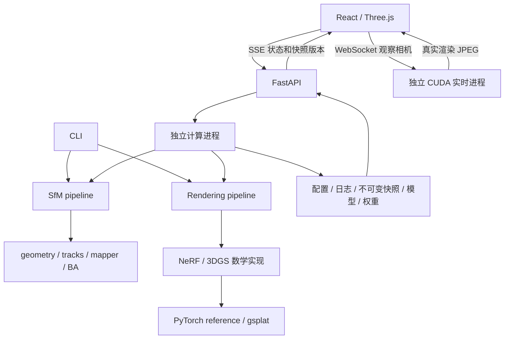

# 架构与实现

Mini-COLMAP 将增量 SfM、固定位姿的新视图训练和本地结果检查连接起来。CLI 与工作台调用同一套 Python 流水线；前端仅调整显示与观察相机，不修改估计地图和训练参数。

## 模块关系

| 目录 / 模块 | 作用 |
| --- | --- |
| `src/minicolmap/models.py` | 相机、位姿、图像、三维点与地图一致性检查 |
| `frontend.py`、`backends.py` | 图像读取、SIFT/匹配、OpenCV PnP 适配 |
| `geometry.py` | 投影、Hartley 归一化、八点法、Sampson 距离、自适应 RANSAC、E 分解与三角化 |
| `tracks.py`、`mapper.py` | 关联轨迹、冲突处理、初始地图、新图像注册与新点补充 |
| `optimization.py`、`ba.py` | 两视图非线性精化、BA 残差、规范自由度约束与候选检查 |
| `pipeline.py`、`timing.py` | SfM 调度、阶段计时、诊断与默认关闭的进度/快照回调 |
| `rendering/algorithms.py` | 射线、位置编码、NeRF MLP、体渲染、高斯参数化、投影、合成、SH 和密度控制 |
| `rendering/data.py`、`pipeline.py` | 训练数据关联、归一化、图像与 K 缩放、Adam、验证与持久化 |
| `rendering/gaussian_backend.py`、`gsplat_runtime.py` | reference/gsplat 接口、像素约定与本机扩展校验 |
| `rendering/live.py`、`ui/live.py` | GPU 常驻渲染进程、会话管理、请求合并和清理 |
| `ui/store.py`、`app.py`、`worker.py` | 资源发现、历史索引、同源接口、任务进程与事件 |
| `web/src/` | 数据/参数面板、点与相机检查器、阶段计时、训练预览与实时视图 |
| `tests/`、`exercises/` | 系统回归与几何、自适应 RANSAC、剪枝、NeRF/3DGS 专项测试 |

## 增量 SfM

1. 校验图像清单、已知内参和文件路径，提取 SIFT 特征。
2. 穷举图像对，执行双向 ratio 匹配与 F-RANSAC 几何验证。RANSAC 依据当前内点率动态缩短采样预算，同时保留最小迭代数和硬上限。
3. 从验证通过的匹配构建特征轨迹，处理同一轨迹内同一图像出现多个特征的冲突。
4. 对初始化候选进行 E 分解、正深度与视差检查、三角化和两视图精化；按有效唯一轨迹点数等条件选取初始地图。
5. 选择具有足够 2D–3D 对应的新图像，用 PnP-RANSAC 估计位姿，补充观测并三角化尚未建点的轨迹。
6. 按配置执行最终全局 BA，验证候选后写回，导出地图及质量报告。

图像对准入可通过 `geometry.min_pair_inliers` 与初始化的 `geometry.min_inliers` 分别设置。轨迹默认使用整组丢弃策略；`mapping.track_conflict_policy=split` 优先合并具有三视图共同支持的连接，遇到同图特征冲突时拒绝该次合并，保留一致的子轨迹。此模式使用观测图，不读参考位姿，不降低 PnP、视差、正深度或重投影要求。

每次运行保存 `matching_graph.json`。若初始相机所在分量不能覆盖所有图像，界面记录对应警告；当前仍构建单一地图，不自动把不连通分量拼接成同一坐标系。

### 初始化的安全剪枝

候选图像对的匹配数是最终有效点数的上界。候选按上界排序；仅当该上界**严格小于**当前合格最佳候选的有效点数时跳过精化。相等时继续评估，以保留视差等次级裁决。完全平局时保留原始输入顺序，排序不修改调用方列表。

该优化减少候选求解次数，不改变 F-RANSAC 的计算。匹配阶段发生在初始化之前，不能将其耗时变化归因于初始化剪枝。

### BA 与运行状态

BA 需要处理单目重建的规范自由度。候选接受与求解器收敛是两个独立状态：误差改善且通过有效性检查的候选可被接受，即使求解器已达到评估预算。界面分别显示未收敛、部分注册、失败与取消。

## NeRF

输入为照片、K 与世界到相机的 R/t，可来自已知位姿清单，也可来自 SfM 模型。实现包括位置编码、带跳连和视角颜色分支的 MLP、密度与 RGB 输出，以及沿射线的 Alpha/透射率积分。训练支持分层采样、单图或跨照片射线采样、固定验证集与分块渲染。

当前没有 coarse/fine 两级网络与层次重要性采样，也不联合优化位姿；它是可解释的基础 NeRF 实现。`nerf_temple_quality.json` 的 near/far 为特定归一化场景配置。

## 3D Gaussian Splatting

每个高斯包含中心、三个对数尺度、wxyz 四元数、不透明度 logit 和实球谐系数。初始化从稀疏点的 RGB 构造球谐 DC 项；旋转与尺度构成三维协方差，经投影 Jacobian 得到二维椭圆，再按深度前向合成。

- 参考后端使用 PyTorch 逐像素计算，可验证数学、梯度与小规模结果。
- CUDA 后端通过 gsplat 光栅；协方差与方向相关颜色仍使用项目中的数学实现。
- 原有密度控制保留为 `legacy`。默认在拓扑变化时迁移 Adam 状态，也可显式选择历史整体重置基线；新增分组学习率、位置衰减、累计屏幕梯度的自适应密度控制及 L1＋SSIM 损失。具体数学选择、消融与原版差异见 [优化说明](3dgs-optimization-ablation.md)，不将其当作原论文完整复刻。
- `max_gaussians` 同时限制初始化子采样和后续增长；增加上限不会自动填满容量。默认增密关闭，设置 `densify_every>0` 后才调用密度控制。

### 球谐约定

最大 degree 为 3，每通道 `(degree+1)^2` 个系数，degree=3 时共 48 个颜色参数。方向使用世界坐标中**相机中心指向高斯中心**的归一化向量 `normalize(mean-C)`；不使用其反向或相机局部方向。

系数使用 Graphdeco 实球谐顺序。0 阶为 `C0=1/sqrt(4π)`；1 阶依次为 `−C1·y, C1·z, −C1·x`，高阶多项式及常量见 `rendering/algorithms.py` 的 `evaluate_sh`。颜色为 `max(0, 0.5 + Σ(coeff·basis))`，不使用 sigmoid；图像导出时再限制到显示范围。初始化 DC 为 `(RGB−0.5)/C0`，其他项为零。

## 坐标、像素与尺度

| 项目 | 约定 |
| --- | --- |
| 位姿 | `X_camera = R @ X_world + t` |
| 相机中心 | `C = -R.T @ t`，R 为合法旋转 |
| 相机轴 | `+X` 右、`+Y` 下、`+Z` 前；像素原点左上 |
| 三维显示 | 相机视锥由 K、图像尺寸与 `R.T` 构造；观察相机转换为 Three.js 的轴约定 |
| 单目尺度 | SfM 输出使用重建坐标单位，不解释为米 |
| 训练归一化 | 保存场景中心与尺度；NeRF 的 near/far 使用归一化距离 |
| 图像缩放 | 与 OpenCV 半像素映射一致：`K_new = A @ K`，`A=[[sx,0,(sx−1)/2],[0,sy,(sy−1)/2],[0,0,1]]` |
| 高斯导出 | checkpoint 保存归一化张量；`gaussians.npz` 的中心、尺度和协方差恢复为原 SfM 世界单位 |

SfM 相机对齐使用约 750 ms 的位置、四元数和视场角过渡；鼠标输入会取消动画，对齐结束后仍可自由控制。

## 本地任务与实时链路

FastAPI 默认仅监听 `127.0.0.1`，训练/重建在独立子进程执行，同一时刻只运行一个计算任务。完整配置在启动时保存，前端通过 SSE 获取真实阶段、计数与版本号，再获取序列化快照；不访问计算中的可变地图。取消终止子进程，保留已有诊断与最后有效快照。刷新页面可重新关联已有任务，但不提供暂停后继续训练。

实时高斯会话将模型一次性加载到独立 CUDA 进程。浏览器只发送观察相机；后端保留一个执行请求和最新待执行请求，避免拖拽积压。CUDA 输出经读回、JPEG 编码与 WebSocket 传输，浏览器按帧号和会话代次提交图像，关闭后回收进程及 GPU 资源。

`outputs/` 存放真实结果，`.cache/mini-colmap-ui/runs/` 是历史索引。刷新时仅移除输出目录已不存在的失效索引，保留运行中、无法访问以及目录仍存在的失败任务。

## 实现范围

项目实现核心几何与渲染数学；OpenCV 提供 SIFT/PnP，SciPy 提供非线性求解器，PyTorch 提供自动微分与优化器，gsplat 提供 CUDA 光栅。当前无稠密 MVS、网格/表面生成、未知内参自标定、完整 COLMAP 模型读取、远程部署或桌面安装包。
