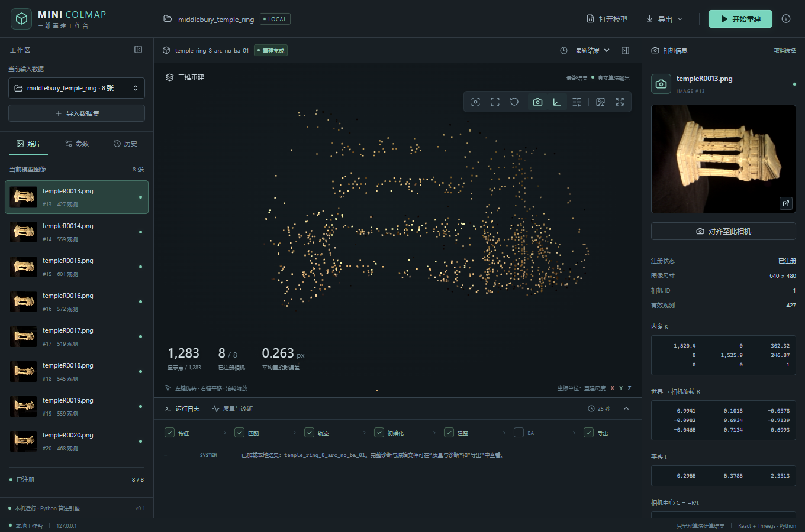

# 一键对齐相机后自由观察

根据反馈，将原来的锁定相机模式改成一次性对齐。点击“对齐至此相机”或“对齐至此观测相机”后，
观察位置、朝向和倾斜角与保存的相机一致，随即仍可旋转、平移和缩放。再次点击可重新对齐。
没有锁定画框或退出模式按钮。快照和选择变化不会自动把自由视角拉回。

前端9项测试、TypeScript检查和生产构建通过。Edge实际验证对齐后立即旋转、平移、缩放、
再次对齐、窗口变化后选点、关联观测入口、切换相机及重置，页面异常为0。
仅改动前端，不改动重建算法，不启动或取消用户任务。

[机器可读记录](report.json) · [操作指南](../../docs/10-可视化工作台.md)

