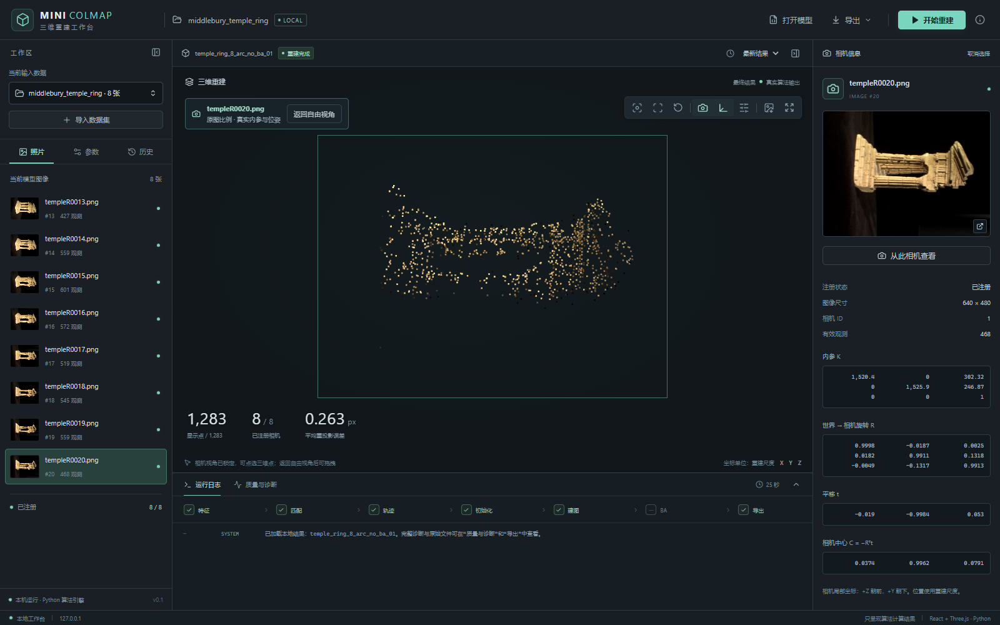
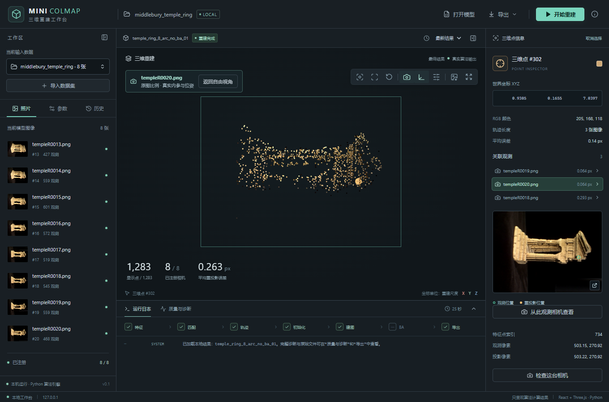

# 相机视角功能验收

此记录对应最初的锁定对照模式。现已根据使用反馈改为一次性对齐后继续自由操作，当前操作见 [工作台指南](../../docs/10-可视化工作台.md)。

2026-10-16，Windows本机Edge。仅修改前端显示；原有重建算法及运行任务未改变。

相机详情新增“从此相机查看”，点详情新增“从此观测相机查看”。
使用保存的K/R/t构造实际观察相机，保留主点偏移、焦距差异与skew，画框保持原图比例。
相机模式可点选三维点，并优先显示该相机的对应观测；返回按钮恢复进入前的自由视角。

前端9项测试通过（新增5项投影与比例测试），TypeScript检查和生产构建通过。
Edge只读验收通过：进入/切换相机、恢复原视角、窗口缩放、按独立计算的像素位置点选、照片观测联动、重置后自由拖拽。
页面JavaScript异常为0。测试没有启动或取消重建任务。原始记录：[report.json](report.json)。

复验：保持本地UI服务运行，在 `web` 执行 `npm run test:e2e:camera`。
