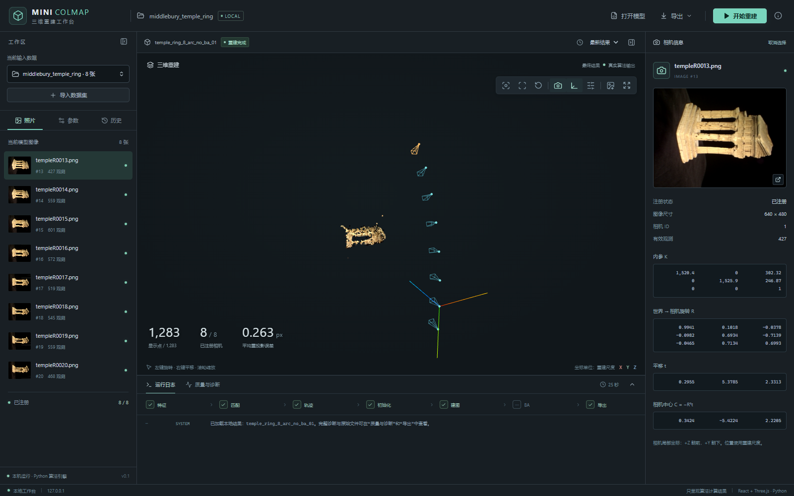
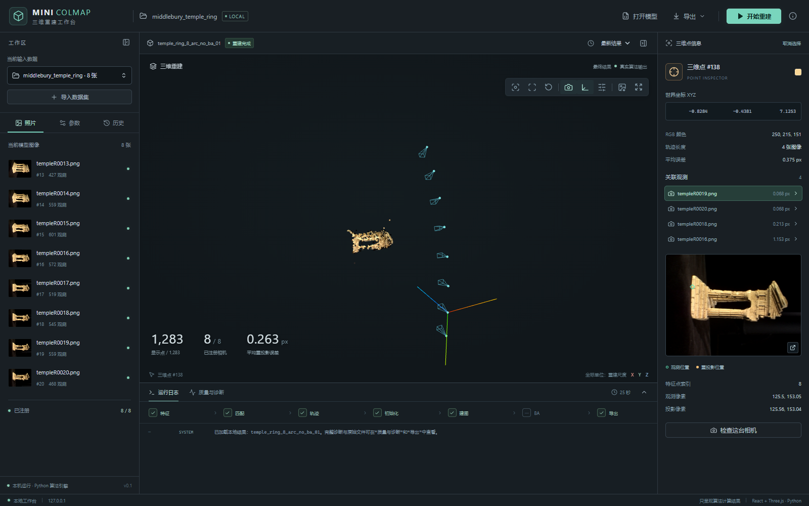
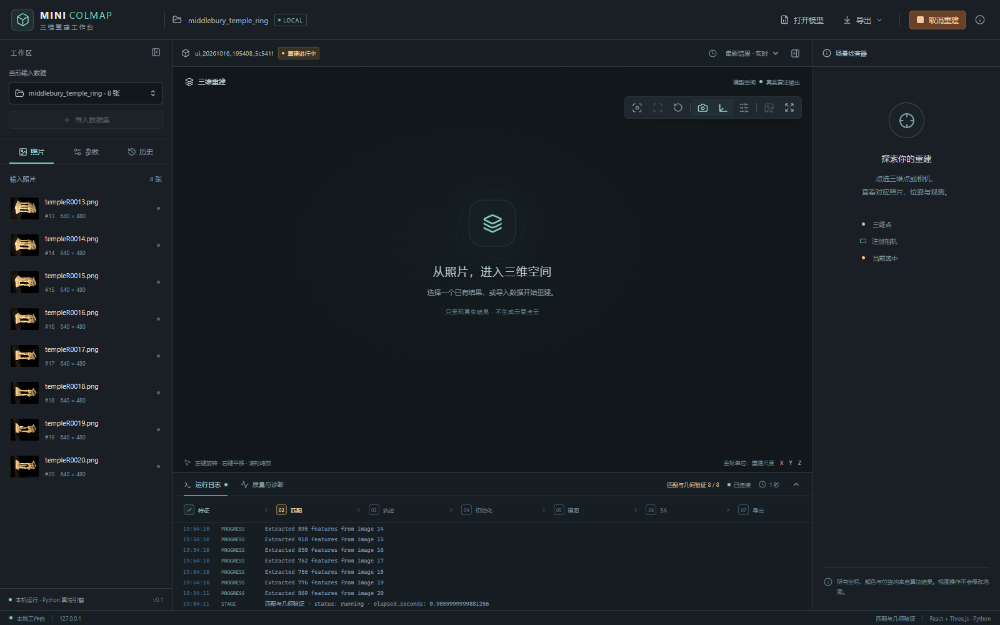
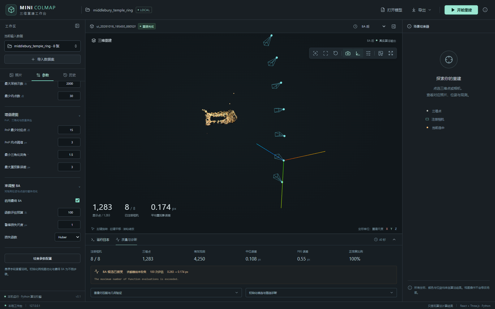

# Mini-COLMAP 工作台验收记录

日期：2026-10-16。环境：Windows、项目Python 3.12虚拟环境、本机Microsoft Edge。

## 交付范围

已实现中文React/TypeScript/Three.js工作台及FastAPI本机服务：数据和模型导入、共享内参校验、完整参数面板、
独立子进程重建、阶段计数、SSE重连、取消、历史、真实场景快照、点云/相机检查、照片观测叠加和文件导出。
前端生产资源已随Python包保存，日常启动无需Node或在线CDN。

几何、track、mapper、BA及优化模块与本次UI开发开始时的文件SHA256一致。
流水线仅新增可选进度通知与模型快照，计算继续调用用户完成的原算法。

## 自动验证

| 验证 | 结果 |
|---|---|
| Python全套算法、工程、观察接口、CLI和UI接口测试 | 202通过 |
| 前端坐标、非单位旋转、去标定和筛选索引测试 | 4通过 |
| TypeScript检查、生产构建、Prettier检查 | 通过 |
| Edge真实页面完整流程 | 通过，页面JavaScript异常为0 |
| 离线wheel构建与内容逐字节检查 | 31项，含4份静态资源；不含Node依赖、缓存和数据集 |

Python测试包含非法内参、尺寸不匹配、初始化失败、部分注册、SSE事件续传、工作进程失败后保留快照、
取消、历史重载、错误数据不被再次发现，以及Windows短暂文件锁处理。
测试输出有一条Starlette测试客户端使用httpx的弃用提示，不影响本次测试结果。

浏览器测试实际完成鼠标旋转、右键平移、滚轮缩放、全屏切换、相机/照片联动、三维点选取和像素观测叠加；
还验证显示筛选、输入照片预览、配置校验、刷新连接运行任务、中间地图切换、BA状态、取消、无原图模型导入和照片/K导入。
完整机器可读记录见 [report.json](report.json)。

## 真实重建结果

数据使用TempleRing的8张连续照片（图像ID13–20），内参与配置沿用已有命令行基线。
从浏览器点击开始后，真正执行SIFT、匹配、几何验证、初始化和增量建图；未使用缓存模型代替计算。

| 项目 | 不启用BA | 启用BA，100次函数评估预算 |
|---|---:|---:|
| 注册相机 | 8 / 8 | 8 / 8 |
| 三维点 | 1,283 | 1,283 |
| 有效观测 | 4,250 | 4,250 |
| 平均重投影误差 | 0.2629256569539256 px | 0.17417349403811835 px |
| BA候选接受 | — | true |
| BA求解器收敛 | — | false |

无BA任务ID：`5c541fe21a894c6a`，输出：`outputs/ui_20261016_195408_5c541f/`，保存9个场景版本（含最终结果）。
带BA任务ID：`88052f5e9a8c4f77`，输出：`outputs/ui_20261016_195450_88052f/`，包含真实BA前/后快照。
两者指标与相同配置的既有命令行结果一致。BA界面显示“候选已接受、求解器尚未收敛”，没有将达到预算标为收敛。

## 截图

相机位姿与照片检查：



点轨迹与照片上的实测/重投影观测：



真实任务中的阶段、计数和日志：



BA后的质量面板：



## 复现

项目根目录启动：

```powershell
.\.venv\Scripts\python.exe -m minicolmap ui --no-browser
```

浏览器打开 `http://127.0.0.1:8765`。另一个终端进入 `web`，运行 `npm ci` 后执行 `npm run test:e2e`。
该测试会创建新任务和导入副本，不修改原始图片及既有基线模型。默认使用独立临时配置的无头Edge；
也可运行 `node e2e/workbench.mjs --headed` 观察执行。日常使用步骤见 [操作指南](../../docs/10-可视化工作台.md)。

验收范围为当前小型稀疏场景与本机Edge；未把大型数据集性能、外部COLMAP模型读取、暂停续算或远程部署列为已实现功能。
