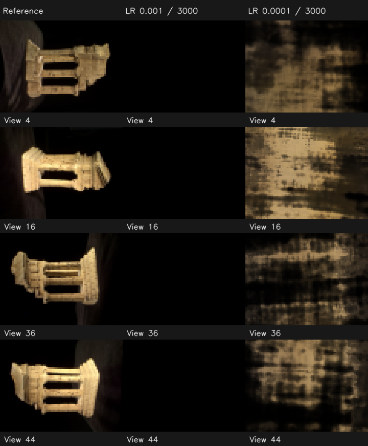

# 深层 NeRF 纯黑图排查（2026-10-17）

## 结论

这次纯黑不是前端显示、图片写入或“密度被 ReLU 全部截成 0”。在真实数据上，新网络沿用了 0.001 的学习率，前约 20 步内密度急升、颜色 logits 急降，最终形成 **完全不透明且 RGB=0 的体积**。颜色 sigmoid 饱和后梯度归零，后续迭代没有把它救回来。

只把学习率降为 0.0001，可以消除本案例的纯黑输出，但 **还没有恢复有效的验证画质**。完整 3000 步后，训练 PSNR 17.72 dB、验证 12.12 dB；所有验证图不再全黑，却有明显伪影。应区分优化塌缩和后续的泛化/几何问题。

本次保留你的算法源码，提供真实对照、诊断配置和复现脚本。没有把局部预览改善当作整体修复。

## 1. 对应哪次运行

失败运行：`outputs/ui_nerf_20261017_223335_35d5f4`。

- TempleRing 47 张：36 训练、11 验证，80×60。
- 位置编码 10 层、方向编码 4 层，8 层位置 MLP、宽度 256。
- 每批 256 射线、每射线 64 点、near=0.1、far=4、seed=0。
- Adam 学习率 0.001，3000 步。
- 第 100、200、500、3000 步保存的第一验证图，8-bit RGB 的最小/平均/最大值都为 **0**。
- 最终验证 MSE=0.0617483、PSNR=12.09375 dB，与对验证照片始终预测全黑的基线一致。

前一次浅网络运行 `ui_nerf_20261017_221621_1e50ad` 同样采样 64 点，验证 PSNR=19.50 dB，但网络深度、宽度、编码层数和密度激活等不同，不能只用两次日志把损失变化归因于一个结构细节。

## 2. 数值证据：不是密度死 ReLU

对失败 checkpoint 抽查第 4 台相机的中心、邻近及角落三条射线，每条 64 个样本：

| 量 | 实际结果 |
|---|---:|
| 激活前密度 | 346.1～670.3 |
| 颜色 logits | −1045.4～−345.8 |
| 射线 opacity | 全部 1.0 |
| 最终 RGB | 全部 0.0 |
| RGB 求和对颜色头权重的梯度范数 | 0.0 |
| RGB 求和对密度头权重的梯度范数 | 0.0 |

原始数据见 [failed-checkpoint.json](failed-checkpoint.json)。密度是很大的正数，ReLU 正在通过它，不是把它截掉。项目的背景是白色：如果密度全为 0，N3 会返回白色，而不是黑色。

`sigmoid(-1000)` 在当前 float32 CUDA 计算中变成 0，其导数也为 0。同时过大的光学厚度使 opacity 饱和到 1，白背景不再透出，后方采样点的贡献被阻断。两个头的退化共同锁住了黑色输出。

## 3. 如何变黑的

使用相同网络、初始化 seed、照片、像素批次和配置，独立复现前 300 步。记录点的训练 loss 与原运行 **完全一致，最大差为 0**。

| 步数 | 样本密度均值 | 颜色 logits 均值 | 射线 RGB 均值 | 颜色头梯度范数 |
|---|---:|---:|---:|---:|
| 1 | 0.01195 | 0.03490 | 0.97763 | 0.01109 |
| 10 | 13.12 | −6.99 | 0.00114 | 0.00293 |
| 20 | 159.79 | −152.58 | 0.0 | 0.0 |
| 100 | 580.88 | −741.75 | 0.0 | 0.0 |

起初密度很小，白背景使预测接近白色。大步更新很快把网络推向“高密度 + 暗颜色”；黑背景照片让这种变化最初能大幅降低损失，但网络越过了可恢复的范围。黑色之后，某些 batch 的 loss 仍在变化，原因是抽到了不同照片和像素，并不代表参数还在有效学习。

详细梯度和每批“预测全黑”的 MSE 对照：[original.json](original.json)。

## 4. 哪些调整实际试过

以下均从相同初始权重和相同数据抽样重新开始，进行 300 步；初始化试验仅显式改变对应初始化。表中 PSNR 都是同一个首验证视角，不与最终 11 视角口径混用。

| 设置 | 首验证视角 PSNR | 观察 |
|---|---:|---|
| 原样，LR=0.001 | 12.75 dB | 全黑、梯度归零 |
| 仅 LR=0.0005 | 12.75 dB | 仍近乎全黑 |
| 仅 LR=0.0003 | 14.43 dB | 中途几乎全黑，300 步恢复少量颜色 |
| 仅 LR=0.0001 | 14.91 dB | 前 300 步输出、梯度没有彻底塌缩 |
| 仅密度偏置初始化为 1，LR=0.001 | 12.75 dB | 仍黑 |
| 仅改 Xavier 权重/零偏置，LR=0.001 | 12.75 dB | 仍黑 |
| 密度偏置 1 + LR=0.0005 | 12.75 dB | 仍黑 |
| 密度 Softplus + LR=0.0005 | 12.75 dB | 仍黑 |

Softplus 对照只在诊断进程用模块包装实现，没有改动用户源文件。上述结果不支持把“换 Softplus”或“改偏置”单独当成这个案例的已验证修复，也不意味着这些方法在所有设置下都无效。

完整原始表：[ablations.json](ablations.json)；对应同名 JSON 含逐步记录、PNG 是真实的 300 步渲染。

## 5. 为什么降低学习率后仍不好

随后用正式训练 pipeline 完整运行 3000 步，**只改 learning_rate=0.0001**，输出在 `outputs/review_nerf_deep_lr1e4_20261017`。

| 指标 | 结果 |
|---|---:|
| 全部训练视角 MSE / PSNR | 0.0169067 / 17.72 dB |
| 全部验证视角 MSE / PSNR | 0.0614288 / 12.12 dB |
| 11 张验证图中整张量化为全黑的数量 | 0 |
| 原来失败运行的验证 PSNR | 12.09 dB |

左：真值；中：原失败 checkpoint；右：只降低学习率后的完整 3000 步 checkpoint。全部来自实际照片或模型渲染，显示仅作最近邻放大。

这一步解决了“所有输出都是黑色”的现象，但验证 MSE 只下降约 0.5%，不能称作画质修复。训练与验证差约 **5.60 dB**，已有明显的泛化问题。逐张原始数据在 [full-evaluation.json](full-evaluation.json)。

抽查各相机随机 256 条射线，渲染权重的集中位置也不合理地靠近相机：

| 相机 | 平均 opacity | 距离 < 0.5 的平均权重 | 平均加权距离 |
|---|---:|---:|---:|
| #3（训练） | 1.0 | 94.57% | 0.178 |
| #4（验证） | 1.0 | 94.50% | 0.183 |
| #16（验证） | 1.0 | 81.95% | 0.311 |

之前的可选 SfM 点诊断中，已有观测点距离约为 0.673～1.111。现在权重大量放在其前方，**与靠近相机的雾幕、记忆各视角外观的失败模式一致**。这不是对全部表面的深度真值证明；尚需独立控制采样区间和采样策略的实验，不能把全部泛化差异归因于 near/far 一个参数。

较低学习率防止数值越界，不会自动保证网络学到正确的三维密度分布。

## 6. 为什么数学测试仍通过

本次 45 项 NeRF/CPU-CUDA 测试通过，完整回归 **408 项通过**：[测试记录](tests.xml)。测试确实包含梯度、状态保存和简单 Adam 闭环，但没有覆盖这组 8×256、10 层编码、真实 47 图参数的长期训练轨迹。

函数数值正确、局部梯度正确，和某一训练配置能否收敛，是不同的验收内容。NaN/Inf 检查也抓不到这里的失败：全黑和零梯度都是有限数。

后续真实训练检查应同时观察颜色 logits、密度、opacity、固定验证图和基线；遇到梯度很小时可用 float64 统计范数/非零数量，以免 float32 平方求和自身下溢。不要仅要求梯度对象不是 None。

## 7. 与原论文实现的关系

[作者公开网络代码](https://github.com/bmild/nerf/blob/master/run_nerf_helpers.py#L72-L107)确实是 8 层、256 宽，并使用位置跳连、独立密度和方向颜色分支。[作者训练/渲染代码](https://github.com/bmild/nerf/blob/master/run_nerf.py)的密度激活也使用 ReLU，默认学习率 5e-4、每批 4096 条射线，并提供随机分层采样等策略。

所以 ReLU 本身不是“偏离原论文”的错误；网络结构接近，也不表示当前项目的初始化、批大小、采样及优化设置等价于原实现。本案例直接改成官方默认 5e-4 仍然失败，已经做了对照。

另有一个结构细节：原作者在 `i==4` 层计算完成**之后**拼接位置编码，进入第 6 层；你当前在 `i==4` 层**之前**拼接，进入第 5 层。若追求逐层一致，需要同步将构造和 forward 的跳连输入位置改到 `i==5`。本次没有修改它，它不是已证明的黑图原因。

## 8. 你现在可以怎么做

1. 为确认优化不再立刻塌缩，可以在前端导入 [nerf_deep_diagnostic.json](../../configs/nerf_deep_diagnostic.json)，创建新训练任务。它是诊断起点，**不是已经恢复高画质的推荐配置**。
2. 重新初始化网络。原失败 checkpoint 的颜色已严重饱和，仅从这个权重继续降低学习率不能视作有效恢复方案。
3. 保留完整验证集，再单独验证更贴近目标的 near/far、随机分层采样等，检查权重是否仍集中在相机前方。当前数据的可选点云可以帮助诊断，但 NeRF 的必需输入仍只有照片和 K/R/t。
4. 基础学习率稳定后，再按独立实验完善初始化、调度、训练预算。每次只比较一种改变，不把“不是黑图了”等同于验收完成。

复现本次诊断的脚本：[diagnose.py](diagnose.py)、[完整低学习率试验](train_diagnostic.py)、[全视角与权重检查](summarize.py)。完整训练脚本拒绝覆盖已有结果；重跑时需要先指定新的输出目录。
