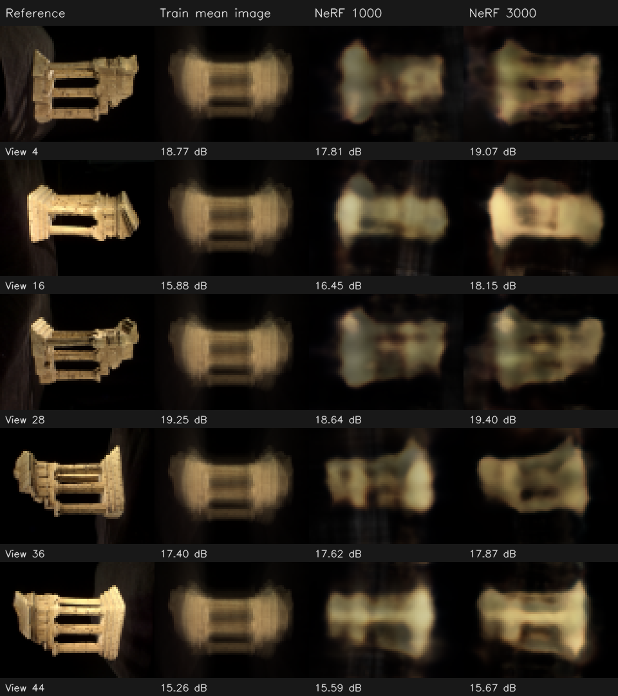

# NeRF 实现验收与真实画质检查（2026-10-17）

N1–N4 可以通过当前教学接口的验收：数值、梯度、GPU 训练、权重保存及新相机渲染均正常。实际照片上已学到随视角变化的外观，但仍明显模糊，不能把“测试通过”理解为已经达到高质量 NeRF。

本次没有修改你的 `rendering/algorithms.py`，增加了 CUDA 测试、独立实验和这份分析。

## 1. 测试结果

| 范围 | 结果 | 主要内容 |
|---|---:|---|
| NeRF 公开算法测试 | 39 / 39 | 射线与 skew、非单位旋转、位置编码、体渲染手算与梯度、网络方向分支、Adam、state_dict |
| 新增真实 CUDA 测试 | 6 / 6 | float32/float64 的 CPU/GPU 前向值、输入梯度及网络参数梯度一致 |
| 完整回归 | 408 / 408 | 原有 363 项 + 上述 45 项；包含原 SfM、初始化剪枝、自适应 RANSAC、UI 接口 |

验收文件：[39 项结果](tests-nerf.xml)、[CUDA 结果](tests-cuda.xml)、[最终回归](regression-final.xml)。唯一 warning 是现有 Starlette/httpx 的弃用提示，不是本次算法失败。

新增测试：[test_nerf_cuda.py](../../tests/support/test_nerf_cuda.py)。没有 CUDA 时这些附加测试会跳过，39 项公开算法测试仍独立存在。

```powershell
.\.venv\Scripts\python.exe -m pytest tests exercises/adaptive_ransac exercises/initialization_pruning exercises/novel_view/test_nerf.py -q
```

## 2. 真实数据和对照方式

原运行：`outputs/ui_nerf_20261017_214716_4f8437`，TempleRing 47 张，36 张训练、11 张验证。原图 640×480，缩小 8 倍后实际训练尺寸是 **80×60**。

配置：CUDA，seed=0，学习率 0.001，每批 256 条射线，每条 32 个采样点，near=0.1、far=4，位置/方向编码层数 6/4，hidden_dim=64；网络共 **12,868 个参数**。

独立对照：`outputs/review_nerf_20261017_3000`，只把迭代数改为 3000。另将源模型的点移除，保留相同照片、内参和 47 个位姿，输入文件是 [camera_only_model.json](camera_only_model.json)。没有重新估计位姿或修改原始结果。

新运行前 1000 步与原运行的所有逐步 loss **完全一致**，第 1000 步预览逐像素完全一致。最终新模型的 source point_count=0，训练照常完成：这验证了当前 NeRF 没有依赖稀疏点云。原运行显示的 6570 点只是输入 SfM 的附带点数，不是 NeRF 生成了 6570 个点。

## 3. 效果如何

这里先求全部对应视角的平均 MSE，再计算 `-10 log10(MSE)`；不是直接对各视角 dB 取平均。

| 方法 | 训练集 MSE | 训练集 PSNR | 验证集 MSE | 验证集 PSNR |
|---|---:|---:|---:|---:|
| 训练照片的全局平均 RGB | — | — | 0.0448065 | 13.49 dB |
| 训练照片逐像素平均图（不使用相机） | — | — | 0.0184059 | 17.35 dB |
| NeRF 1000 步 | 0.0148881 | 18.27 dB | 0.0167915 | 17.75 dB |
| NeRF 3000 步 | 0.0105482 | 19.77 dB | 0.0136183 | 18.66 dB |

3000 步相对 1000 步，验证 MSE 下降 **18.9%**，PSNR 增加 **0.91 dB**。相对无相机的平均图基线，验证 MSE 下降约 26.0%；说明网络学到了一些视角相关信息。但 1000 步只略好于平均图，不能仅根据“loss 下降”就认定三维结构学得很好。



从左到右：原图、仅由训练照片计算的平均图、1000 步 NeRF、3000 步 NeRF。全部是验证照片，显示时仅放大 3 倍以便观察，没有锐化或修图。

- 第 4、16、28 视角的主体和孔洞结构有所改善，细节仍模糊。
- 第 36 视角只从 17.62 增至 17.87 dB；第 44 视角从 15.59 增至 15.67 dB，改善很小。
- 所以应保留多视角验收，不能只看第一个预览视角。3000 步第一个视角是 19.07 dB，全部验证视角合起来只有 18.66 dB。
- 3000 步训练/验证 PSNR 差约 1.11 dB；结合两边都还模糊，目前没有证据表明严重过拟合是首要问题。也不能据此排除局部几何或视角覆盖问题。

原运行耗时 84.30 秒，新运行耗时 129.89 秒。前者是 UI worker，后者是独立脚本，事件写入和系统负载不同，**不能用两者时长计算算法加速比**。新运行 PyTorch 峰值 allocated 约 31.4 MiB、reserved 44 MiB，只统计该进程的 PyTorch 分配，不等于整张显卡占用。

## 4. 保存、坐标和新视角

- 独立加载 checkpoint，重算全部 47 个视角。验证 MSE 与已保存 summary 的差均小于 1e-9。
- 同一验证图 CPU/GPU 浮点 RGB 最大差：1000 步 3.13e-6，3000 步 4.90e-6。
- 通过正式 `render_checkpoint` 接口，使用原世界坐标下的 K/R/t 重渲染第 4 台相机，结果与 image_id 渲染逐像素一致。归一化没有被重复或漏做。
- 对第 3、5 台相机的旋转做 Slerp、相机中心取中点，成功渲染真正的中间相机：[中间视角](interpolated-view.png)。它没有对应真值照片，只能定性检查，不能给它编造 PSNR。

## 5. 代码检查

主要计算逻辑未发现影响这次训练的错误：

1. N1 使用 `-R.T @ t` 和 `directions_camera @ R`，方向单位化；没有额外加半像素，符合项目约定。
2. N2 频率排列符合接口，运算保留 autograd、dtype 和 device。
3. N3 使用有限的末段距离、`expm1` 计算 alpha、排他透射率和剩余背景权重；depth 是约定中的未归一化加权深度。
4. N4 密度只依赖位置，颜色可依赖方向；参数注册正常，softplus 保持非负密度，state_dict 可重载。

有一个不影响合法训练输入的接口小问题：`algorithms.py:179` 在 `_tensor` 校验前访问 `rgb.shape`。输入 None 或 Python list 时实际抛 AttributeError，接口文档约定的是 ValueError。可以先执行 `rgb = _tensor(rgb, 'rgb', (None, None, 3))`，再解包 N/S 并检查 S≥1。这个小调整留给你，不需要改体渲染公式。

另外 `_tensor` 的有限值检查、N1 的相机检查和 N3 的边界检查有多处 `.item()` / 标量判断，会让 GPU 同步。这是后续性能分析的候选点，**本次没有测定它的时间占比，也没有删除保护检查**。

## 6. 为什么还模糊，下一步怎么做

目前是低分辨率、小网络、均匀固定采样的基础版本。单纯增加迭代已有收益，但部分视角明显趋缓，下一步适合做可比较的参数实验。

本场景有一个具体线索：当前 near/far 跨度 3.9，32 个点的间距为 **0.121875 个归一化单位**。仅在训练之后，用已有 SfM 点作诊断，27540 个已观测点距离为 0.673–1.111，全部处于 near/far 内。没有发现这些已观测点被区间裁掉，但整段跨度仅约 3.6 个采样间隔，物体附近采样可能偏稀。这不能证明未观测表面或背景也都被覆盖，也不意味着 NeRF 需要点云。

建议首先保持 3000 步及其他参数不变，只比较 **samples_per_ray=32 / 64 / 128**，观察全部 11 张验证图和耗时；这是待验证假设，不是已经测出的提升。然后单独比较 hidden_dim=64 / 128，最后将 image_downscale 从 8 改到 4（160×120）检验细节。不要一次改全部参数，否则无法判断收益来源。跨分辨率 PSNR 也不能直接视为同一评测口径。

若继续做算法扩展，再为分层采样、随机分层采样、学习率衰减等分别设计测试。N1–N4 基础实现通过验收并不要求现在实现这些扩展；3DGS 的 S1–S5 仍独立待完成。

## 7. 原始证据和复现

- [逐视角 MSE](per-view.csv)：36 张训练图及 11 张验证图、两类平均颜色基线。
- [完整质量统计](quality.json)：CPU/GPU 差、采样区间检查、逐次预览指标、loss 窗口均值。
- [受控实验事件](controlled-events.jsonl)、[设备及峰值资源](controlled-runtime.json)。
- [训练脚本](run_training.py)、[独立评估脚本](evaluate.py)。脚本针对这次固定的 47 图实验，已有输出不会覆盖。

```powershell
# 使用新输出目录重复训练；不会改动原来的 UI 结果
.\.venv\Scripts\python.exe reports/2026-10-17-nerf-implementation/run_training.py --output outputs/nerf_review_repeat

# 评估本报告所对应的原始 1000 步和独立 3000 步结果
.\.venv\Scripts\python.exe reports/2026-10-17-nerf-implementation/evaluate.py
```

评测范围是“外观照片留出”：相机位姿来自之前的全图 SfM，验证图曾参与位姿估计，因此这不是严格的端到端未见图像评测，也不对应官方论文榜单。
