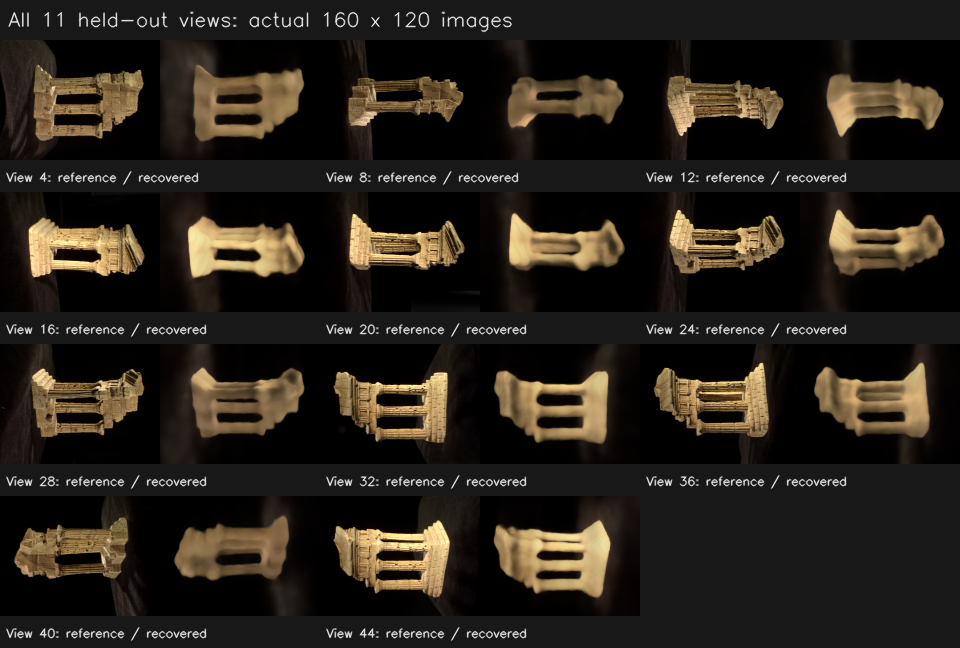

# NeRF 轮廓恢复与工作台验收（2026-10-17）

已将当前47图TempleRing从纯黑/雾幕伪影恢复到**主体外轮廓和孔洞清楚可辨**。完整11个验证视角均已检查，纹理和局部细边缘仍偏软；这次不把它描述成已经完成高质量原论文复现。

左为原图，中为之前只降低学习率的模型，右为恢复后的真实NeRF输出。图像只作最近邻放大，没有锐化、修图或用点云替代渲染。

## 1. 如何直接查看

刷新 [本地工作台](http://127.0.0.1:8765/)，在历史中打开：

**`ui_nerf_20261017_231626_22a05a`**

选择该记录会自动打开训练/渲染工作区；如果当前显示源SfM场景，点击“训练 / 渲染”。可以在“原始相机”下选择 #4、#16、#24、#44 等，再点“渲染此相机”查看保存的模型与原图。

- 输出：`outputs/ui_nerf_20261017_231626_22a05a`。
- 重跑配置：[nerf_temple_quality.json](../../configs/nerf_temple_quality.json)。前端“导入配置”后，关联当前**47图对应的位姿与照片**，创建新任务即可。
- 这次6000步实际训练约 **418秒**；配置、checkpoint、预览和日志均在任务中保存，日常查看不需要重新训练。
- `near=0.55 / far=1.25` 只针对当前47图的归一化空间。换成8图或其他场景，即使仍叫TempleRing，归一化尺度也可能改变，应重新设置深度范围。

## 2. 找到并处理了什么

### 白背景与照片不匹配

之前 `_nerf_rays` 固定传入白色背景，而照片多数背景接近黑色。网络要解释这些黑像素，必须产生有密度的暗色区域去遮挡白背景；与过大的更新、宽深度区间结合后，容易形成相机前方的暗雾幕。

现在背景可选黑/白。当前数据选择黑色，未命中处可直接由黑背景解释，不再要求用不透明黑色体积遮住它。作者[公开渲染代码](https://github.com/bmild/nerf/blob/master/run_nerf.py#L133-L147)同样区分黑背景与可选白背景；背景应匹配数据。

### 密度ReLU的启动问题

新8×256网络在 `levels_xyz=6, seed=0` 下，默认随机初始化曾使探针中的密度全部为0，密度分支失去梯度。这与之前“密度过大造成黑图”是不同的问题。

保留你的8层、256宽、跳连、方向颜色分支和ReLU，仅将密度头bias显式初始化为0.1，使当前归一化场景中的分支可以启动。新增回归会检查密度和密度头梯度不是全零。旧checkpoint加载后会覆盖初始化，不会因这项调整改写旧权重。

### 采样与批次

- 当前场景采样范围从0.1～4收紧到0.55～1.25，减少相机近处无关空间，并把相同64个样本更多地放在主体附近。
- 训练开启有序分层随机深度采样。首点保留near，维持本项目有限区间体渲染的积分范围；预览/新视角渲染仍使用固定采样，保证确定性。
- 每批混合不同训练照片的光线，减少逐张照片之间的梯度摆动；缓存只包含36张训练照片，**不包含11张验证照片的颜色或光线**。
- 位置编码从10层调为6层，降低当前稀疏视角下对高频坐标的记忆。网络拓扑保持你的深层版本。
- 最终用160×120、6000步、每批512条光线、每条64个样本，学习率0.0001。

NeRF必需输入仍是照片、K/R/t。没有加入依赖稀疏点云的训练初始化，也没有修改SfM几何、照片或位姿。

## 3. 实验依据

| 诊断运行 | 尺寸/步数 | 全验证集PSNR |
|---|---|---:|
| 之前仅降低学习率，白背景 | 80×60 / 3000 | 12.12 dB |
| 首轮黑背景对照 | 80×60 / 1500 | 18.76 dB |
| 首轮仅收紧深度范围，仍白背景 | 80×60 / 1500 | 14.98 dB |
| 6层编码+可用密度初始化，仍白背景 | 80×60 / 1500 | 12.90 dB |
| 黑背景、受限区间、6层编码、随机采样、混合批次组合 | 80×60 / 1500 | 23.62 dB |
| 最终工作台运行 | 160×120 / 6000 | **24.17 dB** |

原始配置、日志指标和时长见 [screen-results.json](screen-results.json)。首轮黑背景/范围对照早于密度初始化修复，后两组使用显式正bias；这些运行并非每组都只改一个因素，不能把组合收益拆成各因素可加的贡献。它们用于定位问题，最后以完整模型的同分辨率重渲染验收。

最初6层编码的全零密度探针使一组诊断提前停止；该不完整运行没有计入上表，也没有冒充成功结果。当前脚本重新运行使用修复后的初始化。

## 4. 同相机、同分辨率的最终对比

下面全部使用同11个验证相机，先求平均MSE，再算PSNR；旧模型与新模型都按表中分辨率重新渲染，避免把低分辨率分数与高分辨率分数直接相减。

| checkpoint | 160×120 MSE | 160×120 PSNR | 80×60 PSNR |
|---|---:|---:|---:|
| 最初纯黑模型 | 0.0635082 | 11.97 dB | 12.09 dB |
| 之前只降学习率的伪影模型 | 0.0632189 | 11.99 dB | 12.12 dB |
| 恢复后的模型 | **0.0038312** | **24.17 dB** | **25.78 dB** |

相对伪影模型，160×120整体MSE降低 **93.9%**；亮度前景区域MSE从0.12808降到0.01094，降低约 **91.5%**。新模型训练集24.44 dB、验证集24.17 dB，之前5.60 dB的训练/验证差距缩小到约0.28 dB。

轮廓另作光度诊断：以真值和预测的最大RGB分量>0.15构建亮度掩码，平均IoU从23.74%提高到85.63%；容差1像素的边界F1从13.32%提高到74.14%。这不是人工标注的语义分割真值，木质背景也可能被计入，所以仍以原图并排检查为准。

全部视角PSNR范围 **23.07～25.44 dB**。最低为#24；没有通过只展示好看的视角隐藏失败图。可放大检查[全部验证图](all-validation.png)或[五个代表视角的前后对照](comparison.png)。

## 5. 确实可保存、可在界面重渲染

- 从保存的checkpoint重新计算全部验证图，MSE与训练summary差约4.2e-11。
- 独立40×30相机的CPU/GPU浮点RGB最大差1.79e-6。
- 在真实Edge浏览器中打开最终任务，确认背景/采样/混合批次配置正确恢复，实际重新渲染未参与训练的#16相机，输出为160×120。
- 界面CPU重渲染与独立GPU渲染量化后最大仅差1个8-bit色阶；刷新后保留刚才的预览。
- 本次保留CPU按需渲染的原有设计。浏览器渲染、截图及刷新整套检查约10秒，不是GPU训练耗时。

证据：[真实浏览器记录](browser-live.json)、[CPU/GPU图片一致性](render-consistency.json)、[工作台截图](workbench.png)。接口夹具的浏览器测试另行通过，夹具图片没有当作训练效果证据。

## 6. 修改文件与兼容性

- [algorithms.py](../../src/minicolmap/rendering/algorithms.py)：只增加密度头正bias初始化；N1/N2/N3公式不变，深层网络主体仍是你的实现。
- [pipeline.py](../../src/minicolmap/rendering/pipeline.py)：背景选择、训练分层采样和仅训练照片的世界光线缓存/混合批次。
- [config.py](../../src/minicolmap/rendering/config.py)：新增 `background`、`stratified_sampling`、`ray_sampling` 的严格校验。
- `RenderingPanel.tsx`及相关类型/校验：新增三个可操作控件，配置导入、历史恢复、保存的checkpoint均携带它们。预编译静态资源已更新。

旧配置缺少新字段时仍按原来的白背景、固定采样、单张照片批次解析；新方案在当前场景preset中显式启用。3DGS默认行为不变。

测试结果：**419项Python回归通过、20项前端单元测试通过、TypeScript与生产构建通过**。新增测试检查：深层密度启动、有限区间常密度解析结果、黑白背景、分层点有序/可复现、评估不消耗随机数、混合池排除验证数据、配置非法值及新参数的保存/重渲染。

## 7. 原始证据与当前边界

- [逐相机、逐分辨率指标](per-view.csv)、[汇总](quality.json)、[环境和源码哈希](environment.json)。
- [最终任务元数据](final-run.json)、[训练对照脚本](experiment.py)、[独立评估脚本](evaluate.py)。
- 原始训练结果保留在任务输出目录；所有对照另建目录，没有覆盖用户之前的结果。

当前达到的是轮廓恢复：细柱边缘仍有圆滑、纹理偏软，木质细节尚未复原。分层重要性采样、更高分辨率和纹理细化可作为下一阶段，不能用图像锐化替代训练改进。验证是照片外观留出，位姿来自全图SfM，不对应严格端到端未见数据或官方榜单。
