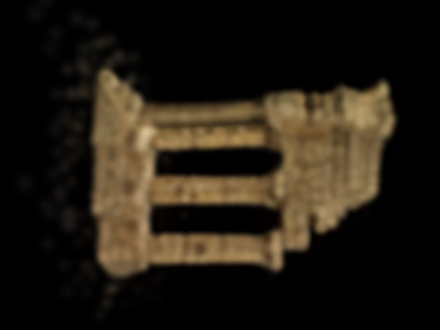
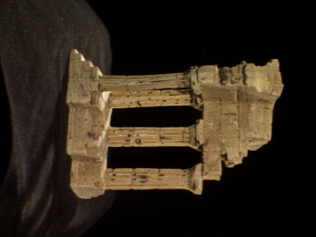

# 3DGS 两轮 3,000 步训练的分辨率与清晰度诊断

日期：2026-10-18。分析对象为用户已经完成的训练；本次没有继续训练、调整权重、修改算法或覆盖实验配置。

## 1. 结论先行

**“不降采样训练更差”目前主要来自评价分辨率不同，不能直接据两次摘要中的 PSNR 判断。** 将两份权重放在同一分辨率、同一批验证相机下重渲染后：低分辨率上，降采样 4 的模型领先约 0.21 dB；原始分辨率上，不降采样的模型领先约 0.18 dB。它们各自在自己的训练分辨率略占优势，没有发现原始分辨率训练全面退化。

两者的清晰度都受明显限制。当前高斯基本仍为大而接近球形的软斑，没有密度增长和分裂。提高图像分辨率只提供更细的监督，不能自动给模型增加表达这些细节的高斯。

## 2. 实验身份与比较方法

| 训练 | 输出目录 | 图像尺寸 | 共同配置 |
| --- | --- | --- | --- |
| train_d4 | `outputs/ui_3dgs_20261018_141937_54cd7b` | 160×120 | 3,000 步、全部 6,570 点、36 训练视图、11 验证视图、seed=0、gsplat/CUDA |
| train_d1 | `outputs/ui_3dgs_20261018_142133_695361` | 640×480 | 相同 |

两轮均为统一学习率 `1e-4`、初始尺度 `0.01`、初始透明度 `0.1`、SH degree=3 从开始全部启用、`densify_every=0`，预览间隔 100。实际配置除了 `image_downscale` 外相同。

使用现有 learner 的协方差、SH 及训练时相同的 gsplat 参数，从最终 checkpoint 重渲染全部相机。每份权重分别渲染至 160×120 与 640×480，**不是把低清晰度 PNG 放大以后评分**。真值按项目已有 `INTER_AREA` 和半像素 K 变换重新载入；评价使用浮点 RGB，PNG 仅供观察。

报告 PSNR 为 `-10 log10(所有等尺寸视图的平均 MSE)`；`mean_view_psnr` 另外保存在 JSON 中，不能混为一个口径。预览对应第一台验证相机，训练完成摘要对应全部验证视图。

完整数据：[resolution-comparison.json](resolution-comparison.json)。可复现脚本：[compare_resolution.py](compare_resolution.py)，项目根目录执行：

```powershell
.venv/Scripts/python.exe reports/2026-10-18-3dgs-resolution-live/compare_resolution.py
```

## 3. 公平比较的结果

| 同一评价尺寸 | train_d4 验证 PSNR | train_d1 验证 PSNR | 解释 |
| --- | ---: | ---: | --- |
| 160×120 | 25.6245 dB | 25.4156 dB | d4 领先 0.2089 dB |
| 640×480 | 23.8183 dB | 23.9968 dB | d1 领先 0.1785 dB，MSE 约低 4.0% |

原始两摘要的 `25.6245 vs 23.9968 dB` 同时改变了目标清晰度和评分尺寸，不是公平的好坏比较。640×480 含有更细的纹理、轮廓和背景布料；160×120 的面积缩放先平均掉了很多高频差异，模糊模型也更容易取得高分。界面将两张图铺满同样大小容器时，小图放大还会掩盖这种评分差异。

原始分辨率的真实渲染比较，顺序为降采样 4 训练／原分辨率训练／真值：





两份训练均恢复了主体轮廓与孔洞，但柱面细纹、基座纹理、棱边和背景布料仍明显模糊。d1 并没有恢复出与原图相当的细节。另一个相机 `view40` 的对应图片也保存在本目录，避免仅看单视角。

## 4. 为什么多像素没有变成更多细节

### 4.1 缺少变小和分裂后的高斯

读取最终参数并投影到全部 11 台验证相机，得到：

| 参数 | train_d4 | train_d1 |
| --- | ---: | ---: |
| 高斯数量 | 6,570 | 6,570 |
| 尺度中位数（归一化坐标） | 0.01088 | 0.01103 |
| 透明度中位数 | 0.11076 | 0.11206 |
| 最大轴／最小轴中位数 | 1.069 | 1.066 |
| 640×480 投影 1σ 小／大半轴中位数 | 5.66／5.93 px | 5.75／6.01 px |

投影统计取相机前方且中心落在画面内的高斯，使用项目 learner 的 `cov2d`，包含既有的屏幕空间最小协方差。它描述单个高斯的软斑尺寸，不是整个图像的统一点扩散函数，不能据此精确算出最终分辨率上限。

但这些实测数据已说明关键问题：大多数高斯依然接近球形，在原图上一个标准差就横跨约 6 个像素。用这些大色块去解释 1～3 像素宽的纹理很困难。**不能仅靠提高 SH 阶数解决，因为 SH 主要控制观察方向变化时的颜色，而不是增加同一表面上的空间采样。**

当前 `densify_every=0`，因此没有训练后期产生更小高斯的机会。把 `max_gaussians` 从 6,570 改成 30,000 也不会凭空增加高斯：初始化最多使用现有 6,570 个点，增长还需要密度控制真正执行。当前工程中该参数同时限制初始化与增长，若初始数量已经填满上限，后续也没有增长空间。

### 4.2 统一学习率仍然限制优化

透明度从初始 0.1 到中位约 0.111，尺度从统一 0.01 变到约 0.011，变化仍很有限。仅从“参数变化不大”不能证明局部最优或梯度错误，但结合训练与验证图都模糊，优先检查优化参数分组比继续抬高输出分辨率更合理。

目前每一组参数都用 `1e-4`，官方当前默认对位置、SH、透明度、尺度、旋转分别配置步长，位置另有衰减。参考尺度为：SH DC `2.5e-3`、其余 SH 为 DC 的 1/20、透明度 `0.025`、尺度 `0.005`、旋转 `0.001`、位置从 `1.6e-4` 衰减至 `1.6e-6` 并结合场景空间尺度。**这些是当前官方代码的参照值，不是对本项目已验证的最优值；尤其位置必须适配本项目的归一化单位。** 不能将所有参数一齐改成透明度的学习率。[官方配置](https://github.com/graphdeco-inria/gaussian-splatting/blob/main/arguments/__init__.py)、[参数组与优化器实现](https://github.com/graphdeco-inria/gaussian-splatting/blob/main/scene/gaussian_model.py)。

### 4.3 暂无明显验证集过拟合证据

| 自身训练尺寸 | 全训练视图 PSNR | 全验证视图 PSNR | 差值 |
| --- | ---: | ---: | ---: |
| train_d4，160×120 | 25.6471 | 25.6245 | 0.0226 dB |
| train_d1，640×480 | 24.0290 | 23.9968 | 0.0321 dB |

这批相机相邻且场景较简单，不能用很小的差值证明能泛化至任意远距离新视角。但它支持当前主要是训练拟合能力／优化受限，而不是“训练图很清楚，只是验证图变差”。

最后 100 步平均训练 MSE：d4 为 `0.002708`，d1 为 `0.003927`；第 2,001～2,100 步分别为 `0.003583`、`0.005084`。损失仍在下降，3,000 步并非充分收敛的证据。每步选择一张训练照片，3,000 步平均每张约 83 次；不是每张照片完成了 3,000 次更新。

### 4.4 分辨率与光栅滤波也改变优化问题

固定世界尺度在 640×480 里会覆盖更多像素，但不等于产生更细的空间结构。光栅器还固定使用 `eps2d=.3` 的屏幕空间协方差下限；其单位是像素平方，不随图像边长同比缩放。因此跨分辨率渲染不仅改变像素数量，也改变最小滤波足迹相对物体的大小。[gsplat 光栅参数说明](https://docs.gsplat.studio/main/apis/rasterization.html)。

这是机制分析；本次没有做改变 `eps2d` 的对照，不能将 0.2 dB 的差异全部归给它。也不建议直接将它降为零来追求锐利，那可能引入闪烁、锯齿和梯度不稳定。

训练损失是全图平均 MSE。像素总数变为 16 倍，并不意味着梯度必然变小 16 倍：一个高斯通常也覆盖更多像素，Adam 还按梯度二阶统计归一化，不能用简单的像素计数解释全部训练行为。当前代码的 K 已包含正确的分辨率变换，现有测试也覆盖半像素约定，未发现本轮特有的 K 缩放错误。

## 5. 提高清晰度的实施顺序

### 第一优先：分组优化 + 空间分裂

1. **分组学习率、位置衰减、DC 与高阶 SH 分离。** 先固定分辨率与视角拆分做单因素对照。记录各组梯度和相对更新量，确认尺度、透明度能有效优化。
2. **按局部点距初始化尺度。** 全部点一起用 `0.01` 无法适应不同区域的点密度。参考三近邻距离 RMS，设置重复点下限与极端稀疏点上限；先测初始化覆盖，再观察训练后是否形成合理各向异性。
3. **真正的自适应密度控制。** 累积可见高斯的屏幕空间梯度，按可见次数归一化；小且欠覆盖的高斯克隆，大且梯度高的高斯分裂成更小的高斯，低透明度及异常大高斯剪枝。保留参数的 Adam 一、二阶状态不能每次整体清空；新增高斯的状态必须明确初始化。

原论文将可训练的各向异性协方差与自适应密度控制作为核心，而不是始终固定 SfM 的稀疏点数。本项目目前只实现了其简化教学版本，S1～S6 单测通过不意味着训练优化策略已与论文等价。[原论文 §5 与 §7](https://arxiv.org/html/2308.04079)。

### 第二优先：低清晰度预热后提高训练分辨率

实现训练中的 `4 → 2 → 1` 分辨率计划，在**同一份状态和优化器**上先收敛轮廓，再细化纹理。原论文采用较小分辨率预热，并在 250、500 步上调，SH 也逐阶引入；具体迭代节点需在本项目重新验证，不能把三次独立从头训练误当作预热。[原论文实现细节](https://arxiv.org/html/2308.04079)。

本工程现在没有该训练日程，重新点击不同分辨率的任务是独立训练；当前保存的 checkpoint 也不包含完整优化器状态，不能直接宣称已支持严格续训。

### 第三优先：结构损失与更长训练

在覆盖和密度控制工作后，对照纯 MSE 与 `0.8 L1 + 0.2(1-SSIM)`，并将训练预算从 3,000 增至 7,000，再由固定验证集决定是否继续。一次只改变一项，始终在固定的 640×480 验证集上评分。适度检查主体区域误差与棱边裁剪；不能用黑背景占比将高 PSNR 当作细节清晰的充分证据。

若用户现在只想做一个现有参数内的基线，可在 `image_downscale=1`、全部点、相同其他参数下对照 3,000 与 7,000 步。它能测继续训练的收益，但不会解决没有分裂、轴长难以缩小等结构限制，不宜先盲跑 30,000 步。

**不建议**只在展示时缩小高斯或给渲染图加锐化。前者会改变学到的透明度合成并产生孔洞，后者只能改变显示；均不能替代三维细节拟合。

## 6. 继续采用“用户填空、助手负责测试与工程”的分工

建议下一轮按以下任务准备开发文档和测试，不需要重写已完成的 S1～S6：

| 用户数学任务 | 助手负责的框架与验证 |
| --- | --- |
| Q1：邻域点距尺度初始化 | 重复点／不均匀密度／单位缩放测试、覆盖统计 |
| Q2：分组优化参数及日程 | 参数组身份、SH DC/rest 拆分、归一化单位与更新幅度测试 |
| Q3：屏幕梯度累积、clone/split/prune | 可见计数归一化、分裂尺度变小、保留 ID 与优化器矩迁移测试 |
| Q4：可选结构损失及分辨率预热 | SSIM 边界、损失梯度、半像素 K、阶段切换保留状态测试 |
| 用户不必实现前端 | 参数面板、指标、真实阶段日志、模型展示、相机交互由助手维护 |

所有改进仍应调用用户实现的协方差和球谐颜色；成熟 CUDA 后端承担光栅化。训练后的自由视角查看必须使用训练得到的实际高斯参数和方向相关 SH，不能用原始 SfM 点云、照片贴图或修改颜色代替。

## 7. 已实现：训练后的3DGS自由视角实时查看

工作台在完成的3DGS结果中提供“开启实时渲染”。真实checkpoint只在独立CUDA子进程加载一次，缓存S2三维协方差与透明度，每次相机变化由用户S6计算方向相关颜色，再通过gsplat生成JPEG。相机从原始SfM世界系转换到checkpoint归一化系；相机操作不修改模型。

支持左键旋转、右键平移、滚轮缩放、对齐已有相机、场景适配、全屏、输出尺寸和断线重连。默认640×480为上限，实际尺寸受面板限制；选择1280×720后再全屏可达到720p，Esc退出。关闭、切换结果或退出面板释放GPU子进程；训练与实时会话互斥。

前后端最多保留一个在途请求和一个最新待处理相机。持续输入时仍显示最近完成帧，旧连接/乱序解码拒绝，不把不断变化的鼠标姿态误判为应丢弃所有返回帧。解码后的JPEG按RAF合并，每轮浏览器绘制最多提交一张新图像；静止时不重复计帧。

### 实际验证范围

- 完整Python回归：**569项通过**，包含原算法练习、真实CUDA后端与34项实时协议/相机/资源测试。既有FastAPI/httpx弃用提示仍为一条非失败警告。
- 前端：**38项通过**，TypeScript与生产资源构建通过；覆盖相机转换、内参/半像素、持续输入、乱序、RAF合并和回收。
- 真实本机Edge：实际权重、旋转/平移/缩放、持续拖拽、相机对齐、适配、尺寸变化、重连、关闭后重新打开均通过，无页面异常。见[浏览器验收](live-browser-verification.json)和[工作台截图](live-workbench.png)。

使用用户原分辨率训练结果、RTX4060 Laptop、6570高斯、SH3、1280×720、JPEG85，预热10秒后测量60秒：

| 口径 | 实测 |
| --- | ---: |
| Python客户端接收＋CPU解码 | 78.09 FPS |
| 该链路GPU渲染均值 / P95 | 4.67 / 7.28 ms |
| 该链路编码均值 | 2.45 ms |
| 该链路接收/解码延迟P95 | 17.44 ms |
| Edge生产界面RAF新图像提交 | 91.13 FPS |
| Edge帧间隔P95 | 13.40 ms |
| Edge请求至RAF提交延迟P95 | 18.30 ms |
| Edge测试期间GPU渲染均值 | 4.53 ms |

两条链路分开执行：Python客户端还执行OpenCV CPU解码；Edge使用自身图像解码，因此吞吐不同。浏览器数值来自headless Edge在真实生产组件中的RAF提交与DOM帧号变化，包含请求、CUDA、读回、JPEG传输/解码及等待RAF，**不是物理显示器扫描测量**。它只统计新模型图像，不累计空转RAF或同一图片。

当前6570高斯场景已经具备实时交互能力。尚未用真实10万高斯模型完成同口径压力验收；不能将本次91FPS外推为所有模型的性能保证。JPEG有压缩损失，离线PNG评价仍使用前面独立的浮点图像口径。

完整记录：[720p传输计时](live-transport-720p.json)、[720p浏览器计时](live-browser-performance.json)、[720p截图](live-720p.png)。复现时先关闭其他实时会话：

```powershell
.venv/Scripts/python.exe scripts/check_gsplat_live.py --run-id 695361f9be8042ed --warmup 10 --duration 60 --output .cache/live-720p.json
# web目录运行；读取既有模型，不启动训练
node e2e/gaussian-live.mjs
node e2e/gaussian-live-perf.mjs
```

本轮只实现展示与连接工程，没有修改用户S1～S6或训练优化策略；前述Q1～Q4仍为下一轮用户实现与消融的建议。
