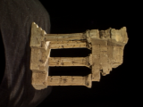
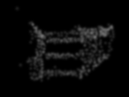

# gsplat兼容修复与3DGS画质调研

2026-10-18。兼容性部分已修复并实测；画质部分保持分析与实验方案，本次没有替换用户的S1–S6数学或改变训练优化策略。

## 1. gsplat现在可通过普通工作台训练

原有环境为PyTorch2.7.1+cu128、gsplat1.5.3、RTX4060 Laptop，系统Toolkit12.3与MSVC14.40存在版本冲突。

本次采用NVIDIA[官方redistributable清单](https://developer.download.nvidia.com/compute/cuda/redist/redistrib_12.8.1.json)下载CUDA12.8.1所需nvcc、cudart、CCCL组件，合计121MiB，逐项SHA256核对后放入`.cache/cuda-toolkit/12.8`，保留组件许可证。系统CUDA、驱动和已有PyTorch均未替换。

Windows编译还有两个独立问题：gsplat1.5.3传给cl的GCC参数`-Wno-attributes`会报D8021；PyTorch的OEM解码在此主机上会用`cp1`并遮住真实错误。构建脚本改用MSVC `/O2 /utf-8`，保存原始诊断并复用已完成的对象文件，不修改已安装库源码。

编译扩展保存在`.cache/torch_extensions/gsplat_cuda/gsplat_cuda.pyd`，登记`.cache/gsplat-runtime.json`，记录Python/PyTorch/CUDA/gsplat版本与二进制SHA256。训练进程加载已验证的扩展，无需日常运行时再设置nvcc/cl。版本变化、文件缺失或校验失败会明确报错，不悄悄复用不兼容二进制。

同时修正适配层：

- 项目整数像素中心与gsplat的`j+0.5,i+0.5`采样约定通过光栅器专用K的主点偏移对齐；源K不变。
- gsplat1.5.3的packed路径背景维度断言有问题，单相机改走dense路径，继续使用tile CUDA光栅器。
- S2仍由用户代码计算三维协方差，S6仍由用户代码计算球谐颜色，原生反向传播连接回全部参数。

验证：实际CUDA前向/反向/Adam通过，整数像素中心对齐、参考/原生数值对照通过；设置`MINICOLMAP_TEST_GSPLAT=1`后全套535项回归通过。普通工作台后台任务`ui_3dgs_20261018_140815_54c91b`完成47照片/512高斯的两步训练及全部11验证视角，真实保存checkpoint、NPZ与两张预览，见[worker记录](worker-verification.json)。这证明兼容性和工程闭环，不是画质或实时FPS验收。

原生扩展版本、SHA256及实际Adam记录见[本机构建验证](native-verification.json)。前端27项测试、TypeScript检查和构建通过；本机Edge实际验证了已自检扩展状态、参数编辑、配置导出/校验、非法设置拒绝和默认恢复，没有页面异常。工作台服务已在无运行任务时重载，刷新页面后选择gsplat+CUDA即可使用。

复现环境：

```powershell
.\.venv\Scripts\python.exe scripts/setup_gsplat_cuda.py
.\scripts\with_gsplat_env.ps1 -PythonArgs @('scripts/build_gsplat_extension.py')
# 上一步编译、实际CUDA自检并登记后，普通启动即可使用gsplat
.\.venv\Scripts\python.exe -m minicolmap ui
```

生成的工具链和二进制在项目缓存中。删除缓存、迁移机器或更新Python/PyTorch时需要重新构建，不把本机二进制视为通用Windows安装包。

## 2. 你这次画质差的实测证据

检查最新完成任务`ui_3dgs_20261018_134016_acf89b`，直接读取其真实权重和原始照片，重新评估全部11个验证视角。配置：47张照片，36训练视角，160×120，reference/CUDA，300步，统一Adam学习率1e-4，SH3阶立即启用，增密关闭，每一步都预览/保存。

| 观察 | 实际值 | 含义 |
|---|---:|---|
| 输入稀疏点 | 6570 | 已有更多可用初始化点 |
| 参与训练的高斯 | 512，约7.8% | 当前上限导致稳定子采样 |
| 每训练相机平均被采样次数 | 300/36≈8.3 | 不是每张图训练了300轮 |
| 全验证PSNR | 13.096dB | 当前画质确实较差 |
| 全黑图基线PSNR | 11.972dB | 当前模型仅比全黑高约1.12dB |
| 透明度中位数 | 0.10269，初值0.1 | 没有学到足够遮挡/覆盖 |
| 尺度中位数 | 0.01026，初值0.01 | 300步中几何支撑大小几乎没变 |
| 相机#4近似前景alpha中位数 | 0.07096 | 解释了结构能看到但整体很淡 |

“近似前景”仅使用目标RGB最大通道>0.15的阈值，包含布景等，不是GT物体分割，不用它当正式前景指标。
精确数值、逐视角结果和KNN尺度分布见[诊断JSON](quality-diagnostics.json)，复现脚本为[analyze_quality.py](analyze_quality.py)。

| 300步真实渲染 | 对应原图 | 渲染不透明度 |
|---|---|---|
|  |  |  |

本次固定预算两步的全验证PSNR，reference为12.865dB，gsplat为12.834dB，差约0.032dB（光栅裁剪/低alpha阈值等不完全相同）。这只是短预算对照，但支持“换快光栅器本身不会自动补足覆盖和学习量”的判断。不要把加速器可用等同于画质已改善。

## 3. 对照原论文和官方实现，优先补什么

下面的贡献大小仍是待消融验证的判断；证据来自上表和训练器代码，不把建议写成已经测得的画质提升。

### P0：先利用已有点，安排足够训练预算

先把初始化上限提高到至少6570（例如10000），保留完整点云；在固定分辨率下分别对照300与3000步，再决定是否到7000步。预览/保存间隔改为100或250，避免每一步把GPU同步、PNG、NPZ和checkpoint写盘都放进训练。

300步只给每个训练相机平均约8次机会，仍接近初始化状态。当前512个高斯的3近邻均方距离平方根中位数约0.03038，而统一初始尺度为0.01；稀疏子采样后覆盖更容易不足。全6570点的同一KNN统计中位数约0.00821，说明“点数”和“初始尺度”需要一起考察，不能对所有点密度使用同一个固定尺寸。
原论文使用自适应密度控制；官方实现根据局部点距初始化尺度，而不是全场固定值，见[论文§5](https://arxiv.org/html/2308.04079#S5)和[官方初始化](https://github.com/graphdeco-inria/gaussian-splatting/blob/main/scene/gaussian_model.py)。

### P1：参数分组学习率，比统一提高learning_rate更合适

当前所有量都用1e-4。官方实现对位置、颜色、透明度、尺度、旋转采用不同Adam参数组，并对位置退火。尤其当前透明度和尺度几乎不动，直接反映了统一小步长的局限。

| 参数组 | 当前 | 当前官方main供参考 |
|---|---:|---:|
| 位置 | 1e-4 | 初始1.6e-4×场景尺度并退火 |
| SH DC | 1e-4 | 2.5e-3 |
| SH其余系数 | 1e-4 | DC/20=1.25e-4 |
| opacity logit | 1e-4 | 2.5e-2 |
| log尺度 | 1e-4 | 5e-3 |
| 旋转 | 1e-4 | 1e-3 |

来源：[官方参数](https://github.com/graphdeco-inria/gaussian-splatting/blob/main/arguments/__init__.py)、[官方优化器分组](https://github.com/graphdeco-inria/gaussian-splatting/blob/main/scene/gaussian_model.py)。这里记录2026-10-18的main，不能把它当成冻结的2023版全部设置；位置学习率还须按本项目归一化换算。
建议下一轮单独实现分组及位置调度，固定相机、初值、训练预算对照。不要一次把所有参数统一放大到透明度的量级。

### P1：局部点距尺度初始化

对每个点使用3个邻居距离的均方根作为初始化尺度，处理重复点/极小距离，并在归一化坐标中明确单位。它会随点云密度变化，较适合全6570点的非均匀分布。极端离群点可导致很大尺度，需要先统计分布并设计有依据的边界，不凭图像效果随意裁数值。
此项应另加固定邻居、尺度一致性、重复点、梯度边界测试，继续由你实现。

### P2：把S5练习扩展为真正的自适应密度策略

当前S5是确定性复制/剪枝练习；训练器传入当前一步的三维中心梯度，拓扑变更会重建Adam。与论文实践还有明显距离：

- 原版累计可见高斯在屏幕空间的梯度，并除以观察次数；不是直接用单步世界坐标梯度。
- 根据梯度和相对尺度做clone/split，配合透明度及过大屏幕投影剔除。
- 要给高斯数量增长留空间；若初值已填满max_gaussians，当前S5无法追加孩子。
- 拓扑变化要迁移保留项的优化器状态，新项初始化状态；每次清空所有Adam动量会改变优化过程。
- 周期性opacity reset应结合增密窗口验证，不把它当作孤立的“调亮”开关。

参考[论文自适应密度控制](https://arxiv.org/html/2308.04079#S5.SS2)、[官方梯度统计与拓扑操作](https://github.com/graphdeco-inria/gaussian-splatting/blob/main/scene/gaussian_model.py)、[gsplat策略文档](https://docs.gsplat.studio/main/apis/strategy.html)。

### P2：SH升阶与损失

先用DC学习粗外观，再逐步启用到3阶；可用现有`sh_degree_interval=1000`，但需至少3000步才覆盖全部阶数。在300步实验里设置1000意味着始终只有DC，应正确解释实验。
随后比较MSE与`0.8*L1+0.2*(1-SSIM)`，检查窗口、值域、边界及梯度。官方实现每1000步升SH阶，并结合L1与结构损失，见[官方训练循环](https://github.com/graphdeco-inria/gaussian-splatting/blob/main/train.py)。这两项均应放在覆盖、学习率和基础拟合之后，不能用更复杂外观掩盖未收敛的几何。

### P3：多视角质量、分辨率与抗锯齿

先确认固定单张训练视图能明显拟合，再检查36训练/11验证的差距。若单张也拟合不好，优先查表示容量和优化；若训练清楚但验证重影，检查位姿/几何/过拟合。
160×120通过后再提高分辨率；最后比较classic和antialiased。增加分辨率不会自动增加高斯覆盖，抗锯齿也不能补出缺失表面。

## 4. 建议的最小消融表

| 实验 | 改什么 | 其余固定 | 目的 |
|---|---|---|---|
| A0 | 现有512点/300步 | 保存当前结果 | 已有基线 |
| A1 | 完整6570点，仍300步 | LR、尺度、损失 | 检查容量贡献 |
| A2 | A1延长到3000步 | 初始化/优化器不变 | 检查预算贡献 |
| A3 | A2改分组LR和位置调度 | 数据/预算/损失 | 检查学习速度 |
| A4 | A3改局部KNN初始尺度 | 同一点序 | 检查覆盖与初始大小 |
| A5 | A4加入屏幕梯度增密 | 记录点数/显存 | 检查自适应容量 |
| A6 | 分别比较SH升阶、L1+SSIM | 每次仅加一项 | 检查外观/结构收益 |

A1之后建议同用gsplat，保留固定种子与输入，记录所有验证视角的PSNR、代表性原图对照、opacity覆盖、高斯数、显存和训练时间。各项仍是方案，本次没有执行长训练或宣称提升值。

`rays_per_batch`、`samples_per_ray`、`near/far`射线区间、`stratified_sampling`和`ray_sampling`在当前3DGS训练分支中不参与射线采样。继续调这些NeRF参数不会解决本轮高斯画质；3DGS裁剪在光栅接口中独立处理。
